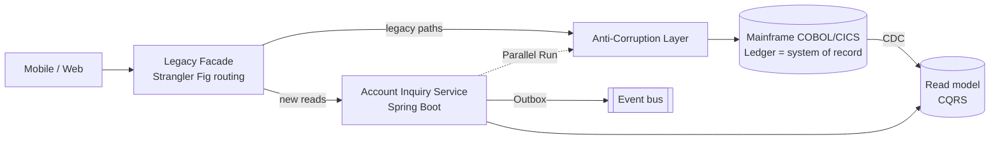
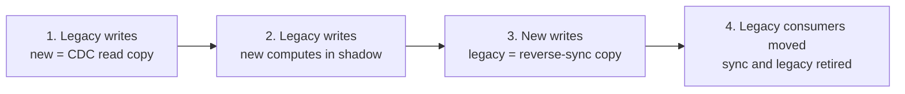
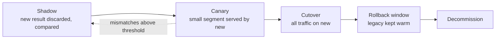

# Legacy Modernization Patterns


[](LICENSE) [](#how-the-patterns-fit-together) [](#why) [](https://spring.io/projects/spring-boot) [](https://eur-lex.europa.eu/eli/reg/2022/2554/oj) [](examples/account-modernization/) [](https://github.com/wallaceespindola/legacy-modernization-patterns/actions/workflows/docs.yml)

The idea: the Strangler Fig pattern is the right way to modernize a core banking system, but it is only the migration framework. It does not decide what to extract, how to keep old and new data in step, or how to prove the new system gives the same answers as the old one. Those jobs belong to other patterns, and modernization goes wrong when they are missing.

This repository puts those patterns together, with the banking and mainframe details that generic descriptions leave out, and a small Java module that shows the ones where the details matter most.

## Why

Banks rarely get to replace a core system in one go. The COBOL and CICS estate posts the ledger, runs the end-of-day batch and feeds regulatory reports, and it cannot go offline for a big-bang cutover. Most of it also works. Rewriting it all is expensive and risky, and parts of it are worth keeping on the mainframe.

So modernization happens one capability at a time, while the old and new systems run side by side. That coexistence period is where the real problems are:

- Who owns the data while two systems hold a copy of it.
- How changes flow between the mainframe and the new services, in order and without duplicates.
- What happens when a call to the mainframe times out halfway through a payment.
- How you prove a new interest calculation matches the old one to the cent.

Strangler Fig alone answers none of those questions.

## Core principles

1. **Strangler Fig is the framework, not the whole answer.** Routing moves traffic; other patterns move understanding, data and confidence.
2. **Data ownership is the hard part.** Exactly one system owns writes at any moment. Never dual-write from application code.
3. **Coexistence is a cost.** Every facade, CDC pipeline and reconciliation job is built with its removal date, or the strangler becomes a permanent second system.
4. **Financial correctness gates every cutover.** Reconciliation and audit evidence decide when a capability is done, not passing tests.

## How the patterns fit together



Strangler Fig is the migration framework, DDD decides what to extract, the ACL protects the new design, data and messaging patterns let the two systems coexist, and parallel runs plus reconciliation decide when a capability is actually done.

| Pattern                       | Job in the migration                                                 |
| ----------------------------- | -------------------------------------------------------------------- |
| Strangler Fig                 | Route capabilities from legacy to new services, one at a time        |
| Anti-Corruption Layer         | Translate legacy records, codes and meanings into a clean model      |
| Branch by Abstraction         | Swap an internal module that routing can't isolate                   |
| Domain-Driven Design          | Decide what to extract, by business capability                       |
| Change Data Capture           | Feed new read models from the legacy system of record                |
| CQRS                          | Scale reads separately while writes stay on the ledger               |
| Transactional Outbox          | Publish events reliably with the state change                        |
| Event-Driven Architecture     | Decouple notifications, fraud, audit and analytics                   |
| Saga                          | Coordinate multi-step flows with compensation (never ledger posting) |
| Parallel Run / Shadow Traffic | Prove the new system matches the old one before cutover              |
| Hexagonal Architecture        | Keep the domain independent of the mainframe adapter                 |
| Circuit Breaker + Bulkhead    | Contain failures when legacy dependencies slow down                  |

The ones that usually get left out: a legacy facade, event interception, idempotent consumers, characterization tests, feature toggles, reconciliation, and correlation IDs that follow a request across both worlds.

## Data ownership moves in stages

Write ownership never jumps from the mainframe to the new service in one release. It moves through four stages, and at every stage exactly one system writes:



Reverse synchronization keeps batch jobs and regulatory reports that still read the mainframe working after stage 3. Reconciliation runs at every stage, and a stage is finished only when it comes back clean.

## From shadow traffic to decommission

A capability earns production traffic. The new service first runs in shadow, then serves a small segment, and the legacy path stays warm until the rollback window closes:



In a bank, the comparison is the hard part. COBOL `ROUNDED` and Java `HALF_EVEN` differ by a cent, 30/360 and ACT/365 day counts differ by days, and an intraday memo-posted balance is not the end-of-day posted one. A parallel run that does not classify mismatches by cause just produces noise.

## Banking details that change the design

- **Mainframe data is not JSON.** Packed decimals (COMP-3) and EBCDIC text need explicit decoding in the ACL, with tests on real copybook layouts.
- **A timeout is not a failure.** When a posting call times out, the money may or may not have moved. The safe answer is an unknown outcome: ask for the status, retry once with the same idempotency key, and send anything still unclear to reconciliation.
- **Ledger postings have no undo.** A saga can compensate a hold or a notification, but a posted entry is corrected with a reversal entry, never a delete.
- **Regulation shapes the plan.** DORA covers ICT risk, incident reporting and exit strategies for ICT third-party providers that support critical functions; BCBS 239 expects data lineage that survives the migration.

## Choosing patterns

| Goal                            | Patterns                                                  |
| ------------------------------- | --------------------------------------------------------- |
| Replace gradually               | Strangler Fig + ACL                                       |
| Define service boundaries       | DDD + Hexagonal Architecture                              |
| Modernize reads first           | CDC + CQRS                                                |
| Publish reliable events         | Transactional Outbox + EDA                                |
| Replace an internal module      | Branch by Abstraction + characterization testing          |
| Coordinate non-atomic workflows | Saga, only when compensation is meaningful                |
| Prove equivalence               | Parallel Run + financial reconciliation                   |
| Contain failures                | Circuit Breaker + Bulkhead                                |
| Move write ownership            | Staged ownership transfer + reverse sync + reconciliation |

AI helps on the discovery side: mapping dependencies, extracting candidate business rules from COBOL, turning copybooks into schemas and triaging parallel-run mismatches. Static analysis, deterministic tests, reconciliation and expert review still decide what is true.

## Java examples

[`examples/account-modernization/`](examples/account-modernization/) is a small Java 21 module (Maven, JUnit 5, no Spring, no database) that implements the patterns where the details matter most:

| Package | Pattern | What it shows |
| --- | --- | --- |
| `acl` | Anti-Corruption Layer | COMP-3 and EBCDIC decoding, return codes to a sealed result, memo-posted to `PENDING` |
| `interest` | Branch by Abstraction + Parallel Run | 30/360 and HALF_UP legacy vs ACT/365 and HALF_EVEN modern, legacy served, mismatches classified |
| `outbox` | Transactional Outbox + Idempotent Consumer | event and state change committed together, at-least-once relay, duplicate-safe consumer |
| `posting` | Safe financial writes | a timeout as an unknown outcome: status inquiry, one retry with the same key, reconciliation queue |

```bash
cd examples/account-modernization && mvn verify
```

## Further reading

- [Banking Modernization with AI](https://github.com/wallaceespindola/banking-modernization-with-ai) (companion repo: why modernize, strategy options, AI controls and a 90-day plan)
- [Strangler Fig Application, Martin Fowler](https://martinfowler.com/bliki/StranglerFigApplication.html)
- [Patterns of Legacy Displacement, Ian Cartwright, Rob Horn and James Lewis](https://martinfowler.com/articles/patterns-legacy-displacement/)
- [Working Effectively with Legacy Code, Michael Feathers](https://www.oreilly.com/library/view/working-effectively-with/0131177052/) (characterization tests)
- [Regulation (EU) 2022/2554 (DORA)](https://eur-lex.europa.eu/eli/reg/2022/2554/oj)

## Support

If you find this project helpful, please consider:

[](https://www.buymeacoffee.com/wallace.espindola) [](https://github.com/wallaceespindola/legacy-modernization-patterns)

[](https://github.com/wallaceespindola/legacy-modernization-patterns/stargazers) [](https://github.com/wallaceespindola/legacy-modernization-patterns/network/members) [](https://github.com/wallaceespindola/legacy-modernization-patterns/watchers) [](https://github.com/wallaceespindola/legacy-modernization-patterns/issues) [](https://github.com/wallaceespindola/legacy-modernization-patterns/commits/main)

Star the repo on GitHub if it helps your modernization work. It motivates me a lot!

## Author

Wallace Espindola, Solution Architect

- Email: <wallace.espindola@gmail.com>
- LinkedIn: <https://www.linkedin.com/in/wallaceespindola/>
- GitHub: <https://github.com/wallaceespindola/>
- Twitter/X: [@wsespindola](https://x.com/wsespindola)
- Substack: [Code & Coffee by Wallace Espindola](https://wallaceespindola.substack.com)
- Medium: <https://medium.com/@wallaceespindola>
- Dev.to: <https://dev.to/wallaceespindola>
- DZone: <https://dzone.com/users/1254611/wallacese.html>
- Speaker Deck: <https://speakerdeck.com/wallacese>
- Speaker profile: <https://sessionize.com/wallace-espindola/>
- Company: [www.wtechitsolutions.com](http://www.wtechitsolutions.com)
- Buy Me a Coffee: <https://www.buymeacoffee.com/wallace.espindola>

## License

- This project is released under the Apache 2.0 License.
- See the [LICENSE](LICENSE) file for details.
- Copyright © 2026 [Wallace Espindola](https://github.com/wallaceespindola/).
