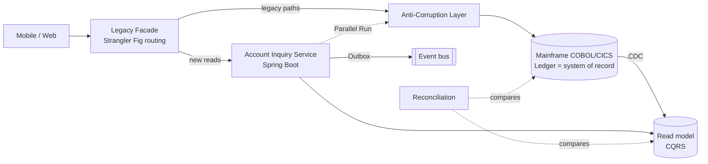
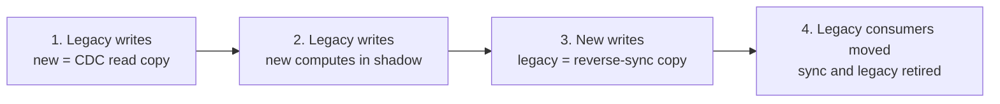
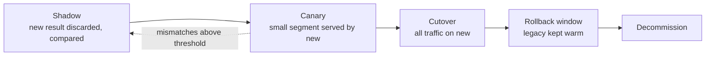

# Legacy Modernization Patterns


[](LICENSE) [](#how-the-patterns-fit-together) [](#why) [](https://spring.io/projects/spring-boot) [](https://eur-lex.europa.eu/eli/reg/2022/2554/oj) [](examples/account-modernization/) [](https://github.com/wallaceespindola/legacy-modernization-patterns/actions/workflows/docs.yml)

The idea: the Strangler Fig pattern is the right way to modernize a core banking system, but it is only the migration framework. It does not decide what to extract, how to keep old and new data in step, or how to prove the new system gives the same answers as the old one. Those jobs belong to other patterns, and modernization goes wrong when they are missing.

This repository puts those patterns together, with the banking and mainframe details that generic descriptions leave out, and a small Java module that shows the ones where the details matter most.

## Why

Banks rarely get to replace a core system in one go. The COBOL and CICS estate posts the ledger, runs the end-of-day batch and feeds regulatory reports, and it cannot go offline for a big-bang cutover. Most of it also works. Rewriting it all is expensive and risky, and parts of it are worth keeping on the mainframe.

So modernization happens one capability at a time, while the old and new systems run side by side. That coexistence period is where the real problems are:

- Who owns the data while two systems hold a copy of it.
- How changes flow between the mainframe and the new services, in order and without duplicates.
- What happens when a call to the mainframe times out halfway through a payment.
- How you prove a new interest calculation matches the old one to the cent.

Strangler Fig alone answers none of those questions.

## Core principles

1. **Strangler Fig is the framework, not the whole answer.** Routing moves traffic; other patterns move understanding, data and confidence.
2. **Data ownership is the hard part.** Exactly one system owns writes at any moment. Never dual-write from application code.
3. **Coexistence is a cost.** Every facade, CDC pipeline and reconciliation job is built with its removal date, or the strangler becomes a permanent second system.
4. **Financial correctness gates every cutover.** Reconciliation and audit evidence decide when a capability is done, not passing tests.

## How the patterns fit together



Strangler Fig is the migration framework. DDD decides what to extract, the ACL protects the new design, data and messaging patterns let the two systems coexist, parallel runs and resilience controls make the journey safe, and reconciliation decides when a capability is actually done.

| Pattern                       | Job in the migration                                                 |
| ----------------------------- | -------------------------------------------------------------------- |
| Strangler Fig                 | Route capabilities from legacy to new services, one at a time        |
| Anti-Corruption Layer         | Translate legacy records, codes and meanings into a clean model      |
| Branch by Abstraction         | Swap an internal module that routing can't isolate                   |
| Domain-Driven Design          | Decide what to extract, by business capability                       |
| Change Data Capture           | Feed new read models from the legacy system of record                |
| CQRS                          | Scale reads separately while writes stay on the ledger               |
| Transactional Outbox          | Publish events reliably with the state change                        |
| Event-Driven Architecture     | Decouple notifications, fraud, audit and analytics                   |
| Saga                          | Coordinate multi-step flows with compensation (never ledger posting) |
| Parallel Run / Shadow Traffic | Prove the new system matches the old one before cutover              |
| Hexagonal Architecture        | Keep the domain independent of the mainframe adapter                 |
| Circuit Breaker + Bulkhead    | Contain failures when legacy dependencies slow down                  |

## The patterns, by the job they do

### Decide what to move

**Domain-Driven Design** finds the boundaries. Event Storming and a context map show the bounded contexts, and the relationships between them show where an ACL is needed. Ledger posting is the core domain and usually moves last, if at all. Inquiry, statements and notifications are supporting domains and make good first candidates. Cut along business capabilities, not along COBOL programs: the program structure reflects old batch and online splits, not what the bank does.

**Hexagonal Architecture** keeps the new domain core independent of where the data lives. The same core runs against a mainframe adapter today and a native repository later, and contract tests on the port prove both adapters behave the same. It also lets the domain be tested without a mainframe test region, which is often the scarcest environment in the bank.

### Route traffic and protect the new design

**Strangler Fig** moves one capability at a time behind a facade. The real design decision is the interception point: an API gateway in front of channel traffic (for example with mainframe functions exposed through z/OS Connect), message interception on MQ, event interception through CDC, or file-level interception for batch. Install the facade early as a pass-through that sends everything to legacy, route per operation rather than per screen, and make rollback a routing change instead of a deployment. Do not forget batch: interest accrual, statements and settlement files often hold more business logic than the online transactions.

**The Anti-Corruption Layer** translates between the two worlds. The syntax part is EBCDIC to UTF-8, packed decimal to `BigDecimal`, fixed-width copybook records to typed objects, and return codes to domain errors. The valuable part is semantics: a legacy "balance" can mean ledger, available or memo-posted balance depending on context, and the ACL has to say which. Keep one ACL per bounded context with no business logic in it, and retire it with the legacy capability behind it.

**Branch by Abstraction** replaces something routing cannot reach, such as an interest calculation called from inside a COBOL program. Put an abstraction in front of it (a CICS `LINK` target or a called subprogram), switch implementations with a feature toggle, and pin current behavior first with characterization tests, including the bugs that downstream systems depend on.

**Circuit Breaker and Bulkhead** contain failures while the mainframe is still in the path. Give each legacy dependency (CICS, MQ, Db2) its own pool, so a slow batch window on one does not starve inquiries on another. Protect the mainframe as well: retries and fan-out raise MIPS consumption, which is often what the bank pays for.

### Keep two systems in step

**Change Data Capture** feeds the new read side from the system of record. Feasibility depends on the data store: Db2 for z/OS has mature log-based tooling, while IMS and VSAM are harder, and that can decide the whole approach. Raw CDC records are legacy-shaped, so they go through a translation step before the read model. Run it with a lag SLO, ordering per account, deduplication and a replay procedure.

**CQRS** lets reads scale on their own while writes stay on the ledger. The mainframe is already the write model, so there is no need for event sourcing. The UX problem is read-your-own-writes: a customer pays and then sees the old balance. Version tokens, pending-transaction overlays and "last updated" timestamps handle it, and if CDC lag breaches its SLO the facade routes balance reads back to legacy.

**Transactional Outbox** publishes an event in the same transaction as the state change, so the two cannot drift. The mainframe has its own version: write the event to a Db2 outbox table or an MQ queue inside the same CICS unit of work. Delivery is at least once, so every consumer needs an **Idempotent Consumer** that records event IDs in the same transaction as its own update.

**Event-Driven Architecture** decouples notifications, fraud monitoring, audit and analytics from the core. Be explicit about the event style (thin notification or event-carried state), partition by account to keep ordering, put schemas in a registry and keep personal data out of events where you can, because erasure on an immutable log is hard.

**Saga** coordinates multi-step flows such as loan origination or onboarding. In banking, compensation is a reversal entry, never a delete. Prefer orchestration for regulated flows, so there is one place to see state and audit it, and put the irreversible steps after the pivot point.

### Prove it and cut over

**Parallel Run** runs the new implementation next to the old one and compares results before any customer sees them. Treat the comparison as a product: tolerance rules, field mapping, a list of known differences, sampling and a triage workflow. The shadow path must not have side effects, and that is enforced by configuration, not by convention.

**Reconciliation** is the real cutover gate. Scheduled, automated comparison of balances and positions between legacy and new stores, with break management, decides when a capability is done. Passing tests do not.

## Data ownership moves in stages

Write ownership never jumps from the mainframe to the new service in one release. It moves through four stages, and at every stage exactly one system writes:



Never dual-write from application code to both stores: a partial failure guarantees they diverge. Reverse synchronization keeps the batch jobs, reports and regulatory feeds that still read the mainframe working after stage 3. Reconciliation runs at every stage, and a stage is finished only when it comes back clean.

## From shadow traffic to decommission

A capability earns production traffic. The new service first runs in shadow, then serves a small segment while legacy is still computed and compared, and the legacy path stays warm until the rollback window closes:



In a bank, most mismatches in that comparison are not bugs. COBOL `ROUNDED` rounds half up while new Java code often uses `HALF_EVEN`, a cent apart on the wrong amount, 30/360 and ACT/365 day counts differ by days, business date and system date drift apart around midnight, and an intraday memo-posted balance is not the end-of-day posted one. A parallel run that does not classify mismatches by cause produces noise instead of evidence.

## A worked example: account inquiry

The starting point is a COBOL core on a mainframe that stays the system of record for ledger posting and settlement. The goal is a Java service for account inquiries and a better mobile experience. Each phase has an exit criterion, and the next one does not start until it is met:

| Phase | What happens | Done when |
| --- | --- | --- |
| 0. Discover | Event Storming and context map, dependency analysis, CDC feasibility per data store, baseline metrics | Bounded contexts agreed and Account Inquiry picked as the first capability |
| 1. Encapsulate | ACL over the legacy account functions, facade installed as a pass-through, correlation IDs end to end | All channel traffic flows through the facade with no change in behavior |
| 2. Build the read side | CDC, translation and a read model with pending and posted balances, lag SLO with fallback to legacy | The read model reconciles with legacy over several business days, including a month-end |
| 3. Prove | Parallel run on balance and inquiry responses, mismatch triage | Mismatch rate below the agreed threshold and every known difference signed off |
| 4. Shift reads | Canary routes per channel or segment up to 100%, legacy kept as fallback | SLOs hold at full traffic and rollback has been tested |
| 5. Extend | Outbox and events for notifications and fraud signals, Branch by Abstraction for the interest calculation | Each replacement passes its own shadow, canary and cutover |
| 6. Decommission | Remove the legacy path, the ACL pieces and the transitional pipelines | Reconciliation clean, audit evidence filed, business and risk sign-off |

## Banking details that change the design

- **Mainframe data is not JSON.** Packed decimals (COMP-3), EBCDIC text, `REDEFINES` and overloaded fields need explicit decoding, with tests on real copybook layouts.
- **A timeout is not a failure.** When a posting call times out, the money may or may not have moved. The safe answer is an unknown outcome: ask for the status, retry once with the same idempotency key, and send anything still unclear to a reconciliation queue. Never blind-retry a non-idempotent write.
- **Ledger postings have no undo.** A saga can release a hold or cancel a notification, but a posted entry is corrected with a reversal entry.
- **Calendars matter.** Cut-off times, end-of-day, month-end and year-end processing, holidays and leap years are where two "equivalent" systems split.
- **Regulation shapes the plan.** In the EU, DORA (applicable since January 2025) covers ICT risk management, major incident reporting and exit strategies for ICT third-party providers that support critical functions. BCBS 239 expects risk data lineage that survives the migration, and PCI DSS scope has to be tracked as card data moves.

## Mistakes to avoid

- **One microservice per COBOL program.** It reproduces the old structure with network latency added.
- **Distributed monolith.** Services that must deploy together or call each other in synchronous chains, usually from splitting along program boundaries.
- **Dual writes** from application code to the legacy and new stores.
- **Shared database integration.** New services reading legacy tables directly and bypassing the ACL.
- **Leaky ACL.** Legacy field names, codes or record shapes showing up in new APIs and events.
- **Ledger first.** Moving the riskiest, most coupled domain before the pipeline is proven on low-risk capabilities.
- **Big-bang data migration disguised as incremental.** Code moves gradually, but all the data moves in one weekend.
- **Perpetual strangler.** No decommission criteria, so the bank runs and pays for both stacks indefinitely.

## When Strangler Fig is the wrong tool

- There is no interception point: no API, queue or data boundary to put a facade on.
- The system is small enough to replace in one well-tested release, and coexistence would cost more than the cutover.
- It is being replaced by a vendor package. That migration is driven by data and process, although parallel runs and reconciliation still apply.
- The capability is stable, cheap to run and not blocking change. Keep it and put an API in front of it.

## Measuring progress

Per capability, track the share of traffic on new services, legacy MIPS consumed, CDC lag against its SLO, the reconciliation break rate and time to resolve, the parallel-run mismatch rate and the number of transitional components still alive. The last one keeps the perpetual strangler visible, because coexistence is usually the most expensive period of the whole program.

## Choosing patterns

| Goal                                        | Patterns                                                    |
| ------------------------------------------- | ----------------------------------------------------------- |
| Replace gradually                           | Strangler Fig + ACL                                         |
| Define service boundaries                   | DDD + Hexagonal Architecture                                |
| Modernize reads first                       | CDC + CQRS                                                  |
| Publish reliable events                     | Transactional Outbox + EDA                                  |
| Consume events safely                       | Idempotent Consumer + dead-letter queue                     |
| Replace an internal module                  | Branch by Abstraction + characterization testing            |
| Coordinate non-atomic workflows             | Saga, only when compensation is meaningful                  |
| Prove equivalence                           | Parallel Run + financial reconciliation                     |
| Contain failures                            | Circuit Breaker + Bulkhead                                  |
| Move write ownership                        | Staged ownership transfer + reverse sync + reconciliation   |
| Safe financial writes over unreliable links | Idempotency keys + status inquiry + reconciliation queue    |
| Modernize batch                             | Job- or file-level strangling + comparison of output files  |
| Debug across both worlds                    | Correlation IDs and tracing through facade, services and MQ |

## The architect and AI

The Solution Architect's job is to pick the pattern for the problem rather than every pattern available, set data ownership and transaction semantics, decide what stays on the mainframe, and record each choice as an ADR, because auditors ask why years later. The architect also owns the transitional architecture: every facade, pipeline and sync job is designed with its removal date, and the roadmap has to show value per phase or funding stops halfway.

AI is useful as a candidate generator: mapping dependencies, extracting business rules from COBOL, turning copybooks into schemas, generating characterization tests from production-like inputs, finding dead code and clustering parallel-run mismatches by cause. Humans and deterministic checks are the gate. Every extracted rule should cite its source program and line, generated tests are validated against real legacy outputs, core banking source stays on approved deployments, and COBOL is re-expressed in the new domain model instead of transliterated line by line into Java.

## Java examples

[`examples/account-modernization/`](examples/account-modernization/) is a small Java 25 module (Maven, JUnit 5, no Spring, no database) that implements the patterns where the details matter most:

| Package | Pattern | What it shows |
| --- | --- | --- |
| `acl` | Anti-Corruption Layer | COMP-3 and EBCDIC decoding, return codes to a sealed result, memo-posted to `PENDING` |
| `interest` | Branch by Abstraction + Parallel Run | 30/360 and HALF_UP legacy vs ACT/365 and HALF_EVEN modern, legacy served, mismatches classified |
| `outbox` | Transactional Outbox + Idempotent Consumer | event and state change committed together, at-least-once relay, duplicate-safe consumer |
| `posting` | Safe financial writes | a timeout as an unknown outcome: status inquiry, one retry with the same key, reconciliation queue |

```bash
cd examples/account-modernization && mvn verify
```

## Further reading

- [Banking Modernization with AI](https://github.com/wallaceespindola/banking-modernization-with-ai) (companion repo: why modernize, strategy options, AI controls and a 90-day plan)
- [Strangler Fig Application, Martin Fowler](https://martinfowler.com/bliki/StranglerFigApplication.html)
- [Patterns of Legacy Displacement, Ian Cartwright, Rob Horn and James Lewis](https://martinfowler.com/articles/patterns-legacy-displacement/)
- [Working Effectively with Legacy Code, Michael Feathers](https://www.oreilly.com/library/view/working-effectively-with/0131177052/) (characterization tests)
- [Regulation (EU) 2022/2554 (DORA)](https://eur-lex.europa.eu/eli/reg/2022/2554/oj)

## Support

If you find this project helpful, please consider:

[](https://www.buymeacoffee.com/wallace.espindola) [](https://github.com/wallaceespindola/legacy-modernization-patterns)

[](https://github.com/wallaceespindola/legacy-modernization-patterns/stargazers) [](https://github.com/wallaceespindola/legacy-modernization-patterns/network/members) [](https://github.com/wallaceespindola/legacy-modernization-patterns/watchers) [](https://github.com/wallaceespindola/legacy-modernization-patterns/issues) [](https://github.com/wallaceespindola/legacy-modernization-patterns/commits/main)

Star the repo on GitHub if it helps your modernization work. It motivates me a lot!

## Author

Wallace Espindola, Solution Architect

- Email: <wallace.espindola@gmail.com>
- LinkedIn: <https://www.linkedin.com/in/wallaceespindola/>
- GitHub: <https://github.com/wallaceespindola/>
- Twitter/X: [@wsespindola](https://x.com/wsespindola)
- Substack: [Code & Coffee by Wallace Espindola](https://wallaceespindola.substack.com)
- Medium: <https://medium.com/@wallaceespindola>
- Dev.to: <https://dev.to/wallaceespindola>
- DZone: <https://dzone.com/users/1254611/wallacese.html>
- Speaker Deck: <https://speakerdeck.com/wallacese>
- Speaker profile: <https://sessionize.com/wallace-espindola/>
- Company: [www.wtechitsolutions.com](http://www.wtechitsolutions.com)
- Buy Me a Coffee: <https://www.buymeacoffee.com/wallace.espindola>

## License

- This project is released under the Apache 2.0 License.
- See the [LICENSE](LICENSE) file for details.
- Copyright © 2026 [Wallace Espindola](https://github.com/wallaceespindola/).
