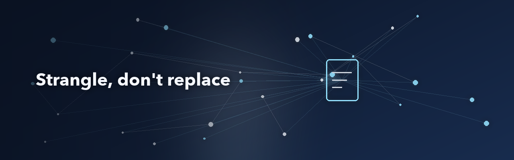
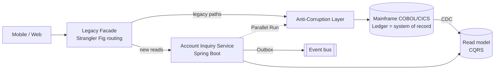

# Legacy modernization patterns for banking

The idea: the Strangler Fig pattern is the right way to modernize a core banking system, but it is only the migration framework. It does not decide what to extract, how to keep old and new data in step, or how to prove the new system gives the same answers as the old one. Those jobs belong to other patterns, and modernization goes wrong when they are missing.

This repository collects those patterns in one place, with the banking and mainframe details that the generic descriptions leave out. It is written as a context file: something to read before a design review, and something to hand to an AI assistant before asking it about a modernization plan.

## Why

Banks rarely get to replace a core system in one go. The COBOL and CICS estate posts the ledger, runs the end-of-day batch and feeds regulatory reports, and it cannot go offline for a big-bang cutover. Most of it also works. Rewriting it all is expensive and risky, and parts of it are worth keeping on the mainframe.

So modernization happens one capability at a time, while the old and new systems run side by side. That coexistence period is where the real problems are: who owns the data, how changes flow between the two worlds, what happens when a call to the mainframe times out halfway through a payment, and how you prove a new interest calculation matches the old one to the cent. Strangler Fig alone answers none of those questions.

## The patterns

| Pattern                       | Job in the migration                                                 |
| ----------------------------- | -------------------------------------------------------------------- |
| Strangler Fig                 | Route capabilities from legacy to new services, one at a time        |
| Anti-Corruption Layer         | Translate legacy records, codes and meanings into a clean model      |
| Branch by Abstraction         | Swap an internal module that routing can't isolate                   |
| Domain-Driven Design          | Decide what to extract, by business capability                       |
| Change Data Capture           | Feed new read models from the legacy system of record                |
| CQRS                          | Scale reads separately while writes stay on the ledger               |
| Transactional Outbox          | Publish events reliably with the state change                        |
| Event-Driven Architecture     | Decouple notifications, fraud, audit and analytics                   |
| Saga                          | Coordinate multi-step flows with compensation (never ledger posting) |
| Parallel Run / Shadow Traffic | Prove the new system matches the old one before cutover              |
| Hexagonal Architecture        | Keep the domain independent of the mainframe adapter                 |
| Circuit Breaker + Bulkhead    | Contain failures when legacy dependencies slow down                  |

The context file covers each of these and adds the patterns that usually get left out: Idempotent Consumer, Event Interception, staged data ownership transfer, reverse synchronization and reconciliation. It also lists the anti-patterns to avoid.

In short: Strangler Fig is the migration framework, DDD decides what to extract, the ACL protects the new design, data and messaging patterns let the two systems coexist, and parallel runs plus reconciliation decide when a capability is actually done.

## What's in the context file

[`docs/legacy-modernization-patterns-context.md`](docs/legacy-modernization-patterns-context.md) contains:

- A catalog of the twelve core patterns, each with banking use cases and pitfalls
- Notes on each pattern for mainframe estates: z/OS Connect and MQ interception, COMP-3 and EBCDIC translation, intraday memo posting vs end-of-day posting, COBOL vs Java rounding, reversal entries as saga compensation, and "unknown outcome" on timed-out financial writes
- Nine missing patterns and eight anti-patterns
- A phased account modernization example with exit criteria for each phase
- What a solution architect owns, including regulatory alignment (DORA, BCBS 239, PCI DSS) and the cost of running both systems
- Where AI helps (rule extraction, copybook-to-schema mapping, parallel-run triage) and the guardrails it needs
- Pattern selection shortcuts, when not to use Strangler Fig, progress metrics, a glossary and references

## How to use it

- **Design reviews:** use the selection shortcuts and the anti-pattern list as a checklist for a modernization proposal.
- **Planning:** start from the phased example and replace the capability (Account Inquiry) with your own.
- **With an AI assistant:** load the file as context (for example, reference it from a `CLAUDE.md` or `.github/copilot-instructions.md`) before asking for designs, ADRs or migration plans. The assistant then starts from the same vocabulary and cautions.
- **Writing:** it is the source material for articles and talks on the topic.

## Repository layout

| Path                                            | Contents                        |
| ----------------------------------------------- | ------------------------------- |
| `docs/legacy-modernization-patterns-context.md` | The pattern catalog and context |
| `docs/images/banner.png`                        | README banner                   |

## Support

If you find this project helpful, please consider:

Star the repo on GitHub if it helps your modernization work. It motivates me a lot!

## Author

Wallace Espindola, Solution Architect

- Email: <wallace.espindola@gmail.com>
- LinkedIn: <https://www.linkedin.com/in/wallaceespindola/>
- GitHub: <https://github.com/wallaceespindola/>
- Buy Me a Coffee: <https://www.buymeacoffee.com/wallace.espindola>

## License

[Apache 2.0](LICENSE)
