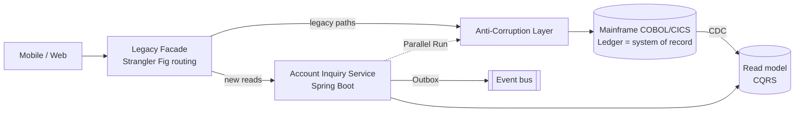

# Legacy Modernization Patterns


[](LICENSE) [](docs/legacy-modernization-patterns-context.md) [](docs/legacy-modernization-patterns-context.md#2-how-the-patterns-work-together-account-modernization-example) [](docs/legacy-modernization-patterns-context.md) [](https://spring.io/projects/spring-boot) [](https://eur-lex.europa.eu/eli/reg/2022/2554/oj) [](examples/account-modernization/) [](https://github.com/wallaceespindola/legacy-modernization-patterns/actions/workflows/docs.yml)

The idea: the Strangler Fig pattern is the right way to modernize a core banking system, but it is only the migration framework. It does not decide what to extract, how to keep old and new data in step, or how to prove the new system gives the same answers as the old one. Those jobs belong to other patterns, and modernization goes wrong when they are missing.

This repository collects those patterns in one place, with the banking and mainframe details that generic descriptions leave out. It is written as a context file: something to read before a design review, and something to hand to an AI assistant before asking it about a modernization plan.

## Why

Banks rarely get to replace a core system in one go. The COBOL and CICS estate posts the ledger, runs the end-of-day batch and feeds regulatory reports, and it cannot go offline for a big-bang cutover. Most of it also works. Rewriting it all is expensive and risky, and parts of it are worth keeping on the mainframe.

So modernization happens one capability at a time, while the old and new systems run side by side. That coexistence period is where the real problems are:

- Who owns the data while two systems hold a copy of it.
- How changes flow between the mainframe and the new services, in order and without duplicates.
- What happens when a call to the mainframe times out halfway through a payment.
- How you prove a new interest calculation matches the old one to the cent.

Strangler Fig alone answers none of those questions.

## Core principles

1. **Strangler Fig is the framework, not the whole answer.** Routing moves traffic; other patterns move understanding, data and confidence.
2. **Data ownership is the hard part.** Exactly one system owns writes at any moment. Never dual-write from application code.
3. **Coexistence is a cost.** Every facade, CDC pipeline and reconciliation job is built with its removal date, or the strangler becomes a permanent second system.
4. **Financial correctness gates every cutover.** Reconciliation and audit evidence decide when a capability is done, not passing tests.

## How the patterns fit together



Strangler Fig is the migration framework, DDD decides what to extract, the ACL protects the new design, data and messaging patterns let the two systems coexist, and parallel runs plus reconciliation decide when a capability is actually done.

## Context summary

The full context is in [`docs/legacy-modernization-patterns-context.md`](docs/legacy-modernization-patterns-context.md). In short:

**The twelve core patterns and their job in the migration**

| Pattern                       | Job in the migration                                                 |
| ----------------------------- | -------------------------------------------------------------------- |
| Strangler Fig                 | Route capabilities from legacy to new services, one at a time        |
| Anti-Corruption Layer         | Translate legacy records, codes and meanings into a clean model      |
| Branch by Abstraction         | Swap an internal module that routing can't isolate                   |
| Domain-Driven Design          | Decide what to extract, by business capability                       |
| Change Data Capture           | Feed new read models from the legacy system of record                |
| CQRS                          | Scale reads separately while writes stay on the ledger               |
| Transactional Outbox          | Publish events reliably with the state change                        |
| Event-Driven Architecture     | Decouple notifications, fraud, audit and analytics                   |
| Saga                          | Coordinate multi-step flows with compensation (never ledger posting) |
| Parallel Run / Shadow Traffic | Prove the new system matches the old one before cutover              |
| Hexagonal Architecture        | Keep the domain independent of the mainframe adapter                 |
| Circuit Breaker + Bulkhead    | Contain failures when legacy dependencies slow down                  |

**Supporting patterns** that usually get left out: API gateway / legacy facade, Event Interception, Idempotent Consumer / Inbox, characterization testing, feature toggles and canary releases, reconciliation, staged data ownership transfer, reverse synchronization, and correlation IDs across both worlds.

**Banking and mainframe details** covered per pattern: z/OS Connect and MQ interception, COMP-3 and EBCDIC translation, intraday memo posting vs end-of-day posting, COBOL vs Java rounding in parallel runs, reversal entries as saga compensation, and "unknown outcome" on timed-out financial writes.

**Account modernization in seven phases**, each with an exit criterion: discover, encapsulate (facade as pass-through), build the read side, prove with a parallel run, shift reads, extend with events and replaced calculations, decommission.

**Pattern selection shortcuts**

| Goal                            | Patterns                                                  |
| ------------------------------- | --------------------------------------------------------- |
| Replace gradually               | Strangler Fig + ACL                                       |
| Define service boundaries       | DDD + Hexagonal Architecture                              |
| Modernize reads first           | CDC + CQRS                                                |
| Publish reliable events         | Transactional Outbox + EDA                                |
| Replace an internal module      | Branch by Abstraction + characterization testing          |
| Coordinate non-atomic workflows | Saga, only when compensation is meaningful                |
| Prove equivalence               | Parallel Run + financial reconciliation                   |
| Contain failures                | Circuit Breaker + Bulkhead                                |
| Move write ownership            | Staged ownership transfer + reverse sync + reconciliation |

**Roles:** the Solution Architect picks the pattern for the problem, sets data ownership and transaction semantics, records decisions as ADRs, and aligns the plan with DORA, BCBS 239 and PCI DSS. AI discovers dependencies, extracts candidate rules, maps copybooks to schemas and triages parallel-run mismatches. Static analysis, deterministic tests, reconciliation and expert review validate everything it produces.

Main sections of the context document:

- [Principal patterns and use cases](docs/legacy-modernization-patterns-context.md#1-principal-patterns-and-use-cases), with [pattern details](docs/legacy-modernization-patterns-context.md#11-pattern-details), [supporting patterns](docs/legacy-modernization-patterns-context.md#12-supporting-patterns) and [anti-patterns](docs/legacy-modernization-patterns-context.md#13-anti-patterns-to-call-out).
- [Account modernization example](docs/legacy-modernization-patterns-context.md#2-how-the-patterns-work-together-account-modernization-example) with phases and exit criteria.
- [Where a Solution Architect adds value](docs/legacy-modernization-patterns-context.md#3-where-a-solution-architect-adds-value).
- [Where AI adds value](docs/legacy-modernization-patterns-context.md#4-where-artificial-intelligence-ai-adds-value), with the risks to manage.
- [Pattern selection shortcuts](docs/legacy-modernization-patterns-context.md#5-pattern-selection-shortcuts), [when not to use Strangler Fig](docs/legacy-modernization-patterns-context.md#when-not-to-use-strangler-fig) and [progress metrics](docs/legacy-modernization-patterns-context.md#measuring-progress).
- [Glossary](docs/legacy-modernization-patterns-context.md#glossary) and [references](docs/legacy-modernization-patterns-context.md#references).

## Who this is for

- Solution and enterprise architects choosing patterns for a mainframe or core banking modernization.
- Engineering leads who need a shared vocabulary for coexistence, data ownership and cutover.
- Teams using AI assistants, who can load the context file before asking for designs, ADRs or migration plans.

## How to use it

- **Design reviews:** use the selection shortcuts and the anti-pattern list as a checklist for a modernization proposal.
- **Planning:** start from the phased example and replace the capability (Account Inquiry) with your own.
- **With an AI assistant:** reference the context file from a `CLAUDE.md` or `.github/copilot-instructions.md`, so the assistant starts from the same vocabulary and cautions.
- **Writing:** it is the source material for articles and talks on the topic.

## Java examples

[`examples/account-modernization/`](examples/account-modernization/) is a small Java 21 module (Maven, JUnit 5, no Spring, no database) that implements the patterns where the details matter most:

| Package | Pattern | What it shows |
| --- | --- | --- |
| `acl` | Anti-Corruption Layer | COMP-3 and EBCDIC decoding, return codes to a sealed result, memo-posted to `PENDING` |
| `interest` | Branch by Abstraction + Parallel Run | 30/360 and HALF_UP legacy vs ACT/365 and HALF_EVEN modern, legacy served, mismatches classified |
| `outbox` | Transactional Outbox + Idempotent Consumer | event and state change committed together, at-least-once relay, duplicate-safe consumer |
| `posting` | Safe financial writes | a timeout as an unknown outcome: status inquiry, one retry with the same key, reconciliation queue |

```bash
cd examples/account-modernization && mvn verify
```

## Repository structure

```text
legacy-modernization-patterns/
├── README.md                                      This file
├── CLAUDE.md                                      Guidance for AI assistants working in the repo
├── Makefile                                       format, lint, links, diagrams, slides, examples
├── LICENSE                                        Apache 2.0
├── .github/workflows/docs.yml                     Markdown lint, link check, Java build
├── examples/account-modernization/                Java 21 pattern examples with tests
└── docs/
    ├── legacy-modernization-patterns-context.md   Pattern catalog and context
    ├── images/banner.png                          Project banner
    ├── articles/                                  Platform articles, banners and diagrams
    └── presentations/                             Marp deck, PPTX, PDF, diagrams, import guide
```

## Working with the docs

```bash
make format     # Prettier, one line per paragraph
make lint       # markdownlint-cli2
make links      # lychee offline link check (needs lychee installed)
make diagrams   # render .mmd and .puml sources to PNG
make slides     # export the Marp deck to PDF and PPTX
make examples   # mvn verify in the Java module
make check      # lint + links + examples
```

Diagrams are Mermaid and PlantUML sources with rendered PNGs next to them. The talk deck is in `docs/presentations/` (see its [import guide](docs/presentations/GOOGLE_SLIDES.md) for Google Slides, Keynote and Speaker Deck).

## Related reading

- [Banking Modernization with AI](https://github.com/wallaceespindola/banking-modernization-with-ai) (companion repo: why modernize, strategy options, AI controls and a 90-day plan)
- [Stop Rewriting Legacy Systems: Use AI to Understand Them First](https://dev.to/wallaceespindola/stop-rewriting-legacy-systems-use-ai-to-understand-them-first-21ba) (Dev.to)
- [Above the Rewrite: How AI Is Changing Legacy Modernization](https://medium.com/@wallaceespindola/above-the-rewrite-how-ai-is-changing-legacy-modernization-ed757a9087a3) (Medium)
- [The Future of Legacy Modernization Isn't a Simple Rewrite](https://wallaceespindola.substack.com/p/the-future-of-legacy-modernization) (Code & Coffee, Substack)

External references:

- [Strangler Fig Application, Martin Fowler](https://martinfowler.com/bliki/StranglerFigApplication.html)
- [Patterns of Legacy Displacement, Ian Cartwright, Rob Horn and James Lewis](https://martinfowler.com/articles/patterns-legacy-displacement/)
- [Working Effectively with Legacy Code, Michael Feathers](https://www.oreilly.com/library/view/working-effectively-with/0131177052/) (characterization tests)
- [Regulation (EU) 2022/2554 (DORA)](https://eur-lex.europa.eu/eli/reg/2022/2554/oj)

## Support

If you find this project helpful, please consider:

[](https://www.buymeacoffee.com/wallace.espindola) [](https://github.com/wallaceespindola/legacy-modernization-patterns)

[](https://github.com/wallaceespindola/legacy-modernization-patterns/stargazers) [](https://github.com/wallaceespindola/legacy-modernization-patterns/network/members) [](https://github.com/wallaceespindola/legacy-modernization-patterns/watchers) [](https://github.com/wallaceespindola/legacy-modernization-patterns/issues) [](https://github.com/wallaceespindola/legacy-modernization-patterns/commits/main)

Star the repo on GitHub if it helps your modernization work. It motivates me a lot!

## Author

Wallace Espindola, Solution Architect

- Email: <wallace.espindola@gmail.com>
- LinkedIn: <https://www.linkedin.com/in/wallaceespindola/>
- GitHub: <https://github.com/wallaceespindola/>
- Twitter/X: [@wsespindola](https://x.com/wsespindola)
- Substack: [Code & Coffee by Wallace Espindola](https://wallaceespindola.substack.com)
- Medium: <https://medium.com/@wallaceespindola>
- Dev.to: <https://dev.to/wallaceespindola>
- DZone: <https://dzone.com/users/1254611/wallacese.html>
- Speaker Deck: <https://speakerdeck.com/wallacese>
- Speaker profile: <https://sessionize.com/wallace-espindola/>
- Company: [www.wtechitsolutions.com](http://www.wtechitsolutions.com)
- Buy Me a Coffee: <https://www.buymeacoffee.com/wallace.espindola>

## License

- This project is released under the Apache 2.0 License.
- See the [LICENSE](LICENSE) file for details.
- Copyright © 2026 [Wallace Espindola](https://github.com/wallaceespindola/).
