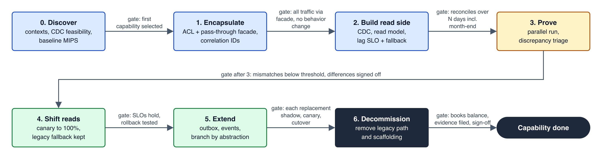

<!-- DZone rejects AI-written text: the author must rewrite this draft in his own words before submitting. -->

<!--
DZone submission metadata
TL;DR (DZone allows 120-170 characters): Govern the coexistence period of a core banking modernization: phase gates with exit criteria, one writer per stage, reconciliation as the cutover gate and a few metrics.
Article type: Analysis
Summary (meta description): A governance model for the coexistence period of a mainframe modernization: roles, phase gates, staged data ownership, reconciliation and metrics for banks.
Primary zone: Software Design and Architecture. Additional zones: Microservices, Java, DevOps.
Tags: legacy-modernization, strangler-fig, mainframe, software-architecture, data-migration, governance
-->

# Legacy modernization: governing the coexistence period


**Author**: Wallace Espindola, Solution Architect
**Email**: <wallace.espindola@gmail.com>
**LinkedIn**: <https://www.linkedin.com/in/wallaceespindola/>
**GitHub**: <https://github.com/wallaceespindola/>
**Companion repo**: <https://github.com/wallaceespindola/legacy-modernization-patterns>

---

A bank that modernizes its core with the Strangler Fig approach lives for a long time in a state that no architecture diagram was drawn for. Some calls already land on new services. Others still reach COBOL programs running under CICS. A CDC pipeline feeds a read model, and every night a reconciliation job checks whether the two sides tell the same story. I call that state the coexistence period. Most of the risk of the program is in it, and so is a big part of the run cost during the transition, since both stacks are paid for along with the scaffolding that joins them.

The technical side of that period has good literature. Martin Fowler's [Strangler Fig Application](https://martinfowler.com/bliki/StranglerFigApplication.html) (the current page is dated 22 August 2024) and [Patterns of Legacy Displacement](https://martinfowler.com/articles/patterns-legacy-displacement/) by Ian Cartwright, Rob Horn and James Lewis (first published 20 July 2021) describe the moves. Governance gets far fewer pages. Who is allowed to flip a route? What evidence does a cutover need? Which system owns the data at each step, and how does anyone find out that the "temporary" architecture is still there three years later?

That governance is my subject here. Read it as a pattern guide and a proposal, based on the catalog and the Java examples in the [companion repository](https://github.com/wallaceespindola/legacy-modernization-patterns). I don't have adoption numbers from a live rollout, and I won't invent any. For the step that comes before all this, AI-assisted discovery of what the legacy system does, see my earlier [Stop rewriting legacy systems, use AI to understand them first](https://dev.to/wallaceespindola/stop-rewriting-legacy-systems-use-ai-to-understand-them-first-21ba). This article is about process: roles, gates, data ownership, reconciliation, metrics and the usual ways a program goes wrong.

## The model in one paragraph

You decide modernization capability by capability, and you move one capability at a time. Each capability (account inquiry, interest, notifications, posting) goes through seven phases. A phase ends with an exit criterion, and I treat that criterion as a gate: the next phase can't start until the evidence for the current one is filed and signed. Data ownership changes in stages, and at every stage there is exactly one writer. The other side receives data through CDC or a reverse-sync path. Application code never writes to both. The cutover gate is reconciliation of balances and positions between the two stores, and a green test suite doesn't open it by itself. Every transitional component gets its removal date on the day somebody creates it.

One more rule sits under all of this: keep rollback a routing change for as long as you can. That stops being true when a new service owns writes, because from then on rollback also means sending data back to legacy. For that reason the ownership transfer is the step I'd guard most in the whole program.

## Roles and decision rights

Coexistence involves two technology stacks, two operations teams and, most of the time, two groups of people who haven't worked together before. If decision rights aren't written down, each incident ends with somebody saying "I thought the other side checked that". In a program charter I'd name these roles:

- **Solution architect:** responsible for the target design, the phase plan and the exit criteria. Writes an ADR for each pattern choice, since auditors and regulators come back years later asking _why_. Also owns the decommission plan of every transitional component.
- **Product or business owner:** responsible for the capability and for the value each phase delivers (MIPS/MSU reduction, time to market, risk reduction). Signs the business side of every cutover. Programs lose funding mid-strangle when nobody can show value per phase, so this person keeps the business case up to date.
- **Risk and compliance:** decides what is accepted as audit evidence, signs any cutover that moves data ownership and checks regulatory alignment. In the EU that includes [DORA (Regulation (EU) 2022/2554)](https://www.eiopa.europa.eu/digital-operational-resilience-act-dora_en), which has applied since 17 January 2025 and covers operational resilience and ICT third-party risk. The same reviews usually bring up data lineage for risk reporting (BCBS 239) and PCI DSS scope for card data.
- **Operations (both stacks):** responsible for the SLOs, the CDC lag alerts, the reconciliation break queue and the rollback drill. They are the ones running the coexistence, so I'd give them a veto on any gate that would add a component nobody monitors.
- **Mainframe engineers:** responsible for legacy behavior, copybooks, batch windows and the CICS side of each interception point. They also know which "bugs" the downstream systems have come to depend on.
- **Modern engineers:** responsible for the new services, the anti-corruption layer, the read model and the comparison tooling used in parallel runs.

I'd pair the last two roles deliberately. The legacy knowledge has to be transferred before its owners retire. And a team built around a bounded context (Conway's Law works here like everywhere else) is simpler to govern than a "mainframe team" that passes tickets to a "cloud team".

The next table shows who signs which gate. R produces the evidence, A is accountable for the decision and C is consulted.

| Gate | Architect | Business owner | Risk and compliance | Operations | Mainframe eng. | Modern eng. |
| --- | --- | --- | --- | --- | --- | --- |
| First capability selected | R/A | C | C | C | C | C |
| Facade carries all traffic, no behavior change | A | | | C | R | R |
| Read model reconciles with legacy | A | | C | C | C | R |
| Parallel-run mismatches explained | A | C | C | | R | R |
| Reads shifted to 100% | C | A | | R | | R |
| Write ownership transferred | C | A | A | R | R | R |
| Capability decommissioned | R | A | A | C | R | C |

You'll see two A's in two of the rows, and that's intended. Transferring write ownership and turning off the legacy path are the two decisions you can't easily undo, so I want a signature from the business and one from risk.

## Seven phases, each with a gate

These phases come from the account modernization example in the context document of the repo. It starts with a COBOL core banking system that remains system of record for ledger posting and settlement. The first capability to leave is Account Inquiry, a low-risk supporting domain. The ledger, which is the core domain, normally goes last or doesn't go at all.



_Figure 1: Phases of one capability with the exit criterion that gates each transition._

### Figure 1 legend

| Color | Meaning |
| --- | --- |
| Blue | Prepare and build scaffolding (no customer-visible change) |
| Yellow | Prove equivalence |
| Green | Move traffic or ownership |
| Dark | Remove scaffolding and close the capability |

Each gate asks for the following:

| Phase | Work | Exit criterion (the gate) |
| --- | --- | --- |
| 0. Discover | Event Storming, context map, dependency analysis, CDC feasibility per data store, baseline MIPS, latency and error rates | Bounded contexts agreed; first capability selected |
| 1. Encapsulate | ACL over legacy account functions, facade installed as a pass-through (100% legacy), correlation IDs end to end | All channel traffic flows through the facade with no behavior change |
| 2. Build read side | CDC to translation to read model, pending vs posted modeled, lag SLO and fallback-to-legacy route | Read model reconciles with legacy within tolerance over N business days, including month-end |
| 3. Prove | Parallel run on balance and inquiry responses, discrepancy triage | Mismatch rate below the agreed threshold; every known difference explained and signed off |
| 4. Shift reads | Canary per channel or segment up to 100%, legacy path kept as fallback | SLOs hold at full traffic; rollback tested |
| 5. Extend | Outbox and events for newly owned events, Branch by Abstraction for selected calculations | Each replacement passes its own shadow, canary and cutover |
| 6. Decommission | Remove the legacy path, ACL pieces and transitional pipelines for the capability | Reconciliation clean, audit evidence filed, explicit business and risk sign-off |

The table is short on four points, so here is a bit more on each.

**N business days, including month-end.** The context file doesn't fix N, and I don't either. Your risk owner picks the number. Whatever it is, the window needs at least one month-end, since batch interest accrual, statements and settlement files all run then. If the capability touches quarter-end or year-end processing, the window should cover those too. Systems that look equivalent usually drift apart on the calendar: cut-off times, holidays, leap years.

**The agreed threshold.** The same idea applies. Fix the threshold before the parallel run begins and write it into the gate. Then leave it alone when the first results arrive. A difference you can explain goes on a known-difference allowlist, with a sign-off. A difference you can't explain blocks the gate.

**Phase 1 is a pass-through on purpose.** A facade that sends 100% of the traffic to legacy may look like ceremony. It isn't wasted work. It shows that the interception point holds, it gives you correlation IDs across both worlds before anything moves and it lets you flip routes later (per operation, per channel or per customer segment) with no change on the client side.

**Phase 5 repeats the gates.** Inside a capability, each new replacement (an interest calculation behind Branch by Abstraction, an event the new side now owns) has its own shadow, canary and cutover. So you can't say a capability is "in phase 5" as one block. Its pieces are, and each piece sits at a different stage.

## Staged data ownership transfer, one writer at a time

Code is the easier thing to move. The authoritative copy of the data is what hurts programs, and in most plans I've read it's also where governance is thinnest: one roadmap line that reads "migrate data".

I'd put a single rule in the charter. Application code never dual-writes to both stores, and at any moment only one system owns writes. With a dual write, the first partial failure makes the two stores diverge. After that, reconciliation spends its time repairing a design flaw, when its job was to catch edge cases.


_Figure 2: Data ownership stages with the gate between each stage and the rollback path from stage 3._

### Figure 2 legend

| Element | Meaning |
| --- | --- |
| Indigo box | Legacy is the single writer |
| Green box | New service is the single writer |
| Solid arrow | Forward transition, labeled with its gate |
| Dashed arrow | Rollback path, which needs data to flow back |

From a governance point of view, the move from stage 2 to stage 3 is the one to watch. Until stage 2, you roll back by routing: the facade points to legacy again and legacy continues, since it was the owner of the data all along. Starting at stage 3, rolling back means giving ownership back to legacy and getting every write the new service took back into it. The reverse-sync path exists for exactly that. So I'd ask more of this gate than of any other:

- shadow computation reconciled cleanly over the agreed window;
- reverse sync (reverse CDC or an ACL write-back) tested end to end, including the rollback direction;
- a rehearsed rollback, with operations owning the runbook;
- sign-off from both the business owner and risk.

Stage 4 hides a trap of its own. The new service owns writes, but legacy batch jobs, reports and regulatory feeds keep reading the legacy store. You can't retire the reverse sync until those consumers have moved, and people forget them, since they never call anyone on the modernization team. List them in phase 0, when you still have time to plan their migration.

## Reconciliation is the cutover gate

A banking cutover is approved on reconciliation and audit evidence. You need the tests too, but what they show is that the code behaves the way the team expects. Reconciliation shows that the books balance against the system that has been correct for decades.

I'd run reconciliation like a product, with an owner and a backlog. In practice that means:

- **Scheduled and automated:** balances and positions compared between the legacy store and the new store on a fixed cadence, with tolerance rules defined up front.
- **Break management:** each break gets a category, an owner and a time to resolve. The break rate is one metric and the time to resolve is another.
- **Pending vs posted:** many cores memo-post during the day and hard-post in the end-of-day batch, and CDC captures both. A read model that doesn't keep pending and posted apart makes reconciliation report breaks that are only timing. The team then stops reading the report, and at that point you'd be better off with no report.
- **Evidence trail:** the reconciliation reports for the gate window are what risk and compliance file as cutover evidence.

For calculations, the parallel run asks for the same discipline. To compare old and new outputs you need field mapping, tolerance rules, a known-difference allowlist, a sampling rate and a triage workflow. Expect the usual false mismatches: rounding mode (COBOL `ROUNDED` is half-up by default, Java `BigDecimal` needs an explicit `RoundingMode`), day-count conventions, business date vs system date, time zones and intermediate truncation. And the shadow path can't produce side effects. Sandboxed stores and stubbed notification and payment adapters have to be forced by configuration, because a convention only works until somebody forgets it.

## When the outcome is unknown, the process has to say so

Gates are not the whole story. Governance also needs an answer for what happens between them, for example when a financial write times out on an unreliable link. If a posting call times out, you don't know the outcome. Maybe the mainframe applied the posting, maybe it didn't. Retry blindly and you may post twice. Give up and you may lose a posting.

The `posting` package in the repo has the shape I'd want the process to require. This is a trimmed version of `examples/account-modernization/src/main/java/com/wallaceespindola/modernization/posting/SafePostingClient.java` (the package line, imports and constructor are left out):

```java
/** Safe posting: on timeout, ask the ledger before retrying, retry once, then reconcile. */
public class SafePostingClient {

    private final PostingGateway gateway;
    private final ReconciliationQueue reconciliation;

    public PostingResult post(PostingRequest request) {
        try {
            return gateway.post(request);
        } catch (PostingTimeoutException timeout) {
            return resolveUnknownOutcome(request);
        }
    }

    private PostingResult resolveUnknownOutcome(PostingRequest request) {
        Optional<PostingResult> alreadyPosted = lookup(request);
        if (alreadyPosted.isPresent()) {
            return alreadyPosted.get();
        }
        try {
            return gateway.post(request);
        } catch (PostingTimeoutException timeout) {
            return lookup(request).orElseGet(() -> park(request));
        }
    }

    private Optional<PostingResult> lookup(PostingRequest request) {
        return gateway.status(request.idempotencyKey())
                .map(status -> new Posted(status.idempotencyKey(), status.reference()));
    }

    private PostingResult park(PostingRequest request) {
        reconciliation.add(request);
        return new Unknown(request.idempotencyKey());
    }
}
```

It's a small class, and three process decisions are written into it. First, the request carries an idempotency key end to end, which lets the ledger answer a status inquiry. Second, after a timeout the client asks the ledger before retrying, and it retries only once. Third, whatever is still open goes to a `ReconciliationQueue`, and the caller gets an explicit `Unknown` result. The client doesn't guess success or failure. What governance adds is an owner for that queue: an operations role with a defined time to resolve, and the queue depth shown on the dashboard next to the reconciliation breaks.

Retries are not free on the mainframe either. They push up MIPS/MSU consumption, and that's often what the bill is based on. So the operations runbook should also set retry budgets and rate limiting at the facade.

## What to measure

If a program has no signals, all that's left to manage is the schedule. I'd track the metrics below for each capability separately, since an average over the whole program hides the one that's stuck:

| Metric | Question it answers | Warning sign |
| --- | --- | --- |
| Share of traffic routed to new services | Is the strangling actually progressing? | Flat for several reporting periods |
| Legacy MIPS/MSU consumed | Is the business case showing up in the bill? | Rising while traffic moves (retries, fan-out, CDC load) |
| CDC lag against its SLO | Can the read side be trusted? | Frequent breaches, fallback to legacy used often |
| Reconciliation break rate and time to resolve | Do the books balance, and how fast are breaks closed? | Breaks accepted as "normal", queue aging |
| Parallel-run mismatch rate | Is the new logic equivalent? | Unexplained mismatches, allowlist growing without sign-off |
| Transitional components still alive | Is the scaffolding being removed? | Count only ever goes up |

If I had to choose one for the first slide of the steering committee, it would be the last row. The facade, the ACL pieces, the CDC pipelines, the reverse sync and the reconciliation jobs are what Patterns of Legacy Displacement calls [Transitional Architecture](https://martinfowler.com/articles/patterns-legacy-displacement/transitional-architecture.html): software installed to ease the displacement of a legacy system and meant to be removed. A count of those components, each with its removal date, shows whether "meant to be removed" is still the plan.

The table has no target values, and that's deliberate. A threshold depends on your volumes, your SLOs and your regulator. What I care about for governance is that every metric has an owner and a warning sign, both agreed before the phase starts.

## Anti-patterns to watch for in reviews

You can catch most of these in a design review, well before production does it for you. I'd list them in the program charter, so that a reviewer has a name for what they see:

- **Perpetual strangler:** no decommission criteria, so the bank runs and pays for both stacks indefinitely. The transitional components metric exists to catch this.
- **Big-bang data migration disguised as incremental:** code moves capability by capability, but all data moves in one weekend. The staged ownership model is the counter.
- **Dual writes** from application code to legacy and new stores. Divergence on partial failure is a matter of time.
- **Ledger first:** moving the highest-risk, most coupled core domain before the pipeline has been proven on low-risk capabilities.
- **Shared database integration:** new services reading legacy tables directly, bypassing the ACL, which couples them to the physical schema.
- **Leaky ACL:** new APIs and events that expose legacy field names, codes or record layouts.
- **One microservice per COBOL program:** 1980s program boundaries reproduced with network latency added, usually ending as a distributed monolith.
- **Gates negotiated after the fact:** thresholds lowered once the first parallel-run results come in. Nothing in the code shows it, so it's the hardest one to spot from inside the team.

## Trade-offs and when this is too much

None of this is free. A gate needs evidence, and somebody has to produce that evidence and file it. Coexistence is already the expensive period, with two stacks, the scaffolding and the reconciliation work all running together. The governance then adds calendar time on top.

So there are cases where it doesn't pay off. Strangler Fig itself is the wrong tool when:

- there is no interception point, no API, queue or data boundary you can put a facade on;
- the system is small enough to replace in one well-tested release, and coexistence would cost more than the cutover;
- you're replacing it with a vendor package, where migration is data and process driven (parallel run and reconciliation still apply);
- the capability is stable, cheap to run and not blocking change, in which case retaining it behind an API is a legitimate outcome.

Even within a strangler program, I'd size each gate to its risk. Moving write ownership of balances deserves the full sign-off chain. A notifications capability fed by an outbox doesn't. Two things I wouldn't relax in any case: the single-writer rule and reconciliation before an ownership transfer. Both cost little next to explaining a divergent ledger to an auditor.

People are part of the cost too. When mainframe and modern engineers pair, both go slower at the start. And if risk has to sign every gate, risk can turn into the bottleneck. Settle in phase 0 which gates need a risk signature and which ones only need risk to be informed.

## Wrapping up

- The coexistence period holds much of the risk and a large part of the run cost of a strangler program, so give it explicit roles and decision rights.
- Each capability goes through seven phases, and each phase ends with an exit criterion that named roles sign as a gate.
- Data ownership changes in stages, with one writer per stage. The strictest gate is the one where the new service takes over writes, since rollback is no longer a routing change after it.
- Reconciliation is the cutover gate. An unknown outcome on a financial write is parked for reconciliation and never guessed.
- Follow a few metrics per capability, and count the transitional components so the strangler doesn't become permanent.

You'll find the phase plan, the pattern catalog and the Java examples (`SafePostingClient` and its tests included) in the [companion repo](https://github.com/wallaceespindola/legacy-modernization-patterns). The gates and the sign-off table are a starting point, so adapt them to your own risk function.

How does your organization decide when a capability is really done? I'm curious whether others formalized the gates and decommission criteria or still run on a cutover weekend and good intentions. Let me know in the comments.

**Examples repository:** <https://github.com/wallaceespindola/legacy-modernization-patterns>

Need more tech insights?
Check out my GitHub, LinkedIn, and Speaker Deck.
Happy coding!

Wallace Espindola, Solution Architect

- GitHub: <https://github.com/wallaceespindola/>
- LinkedIn: <https://www.linkedin.com/in/wallaceespindola/>
- Speaker Deck: <https://speakerdeck.com/wallacese>
