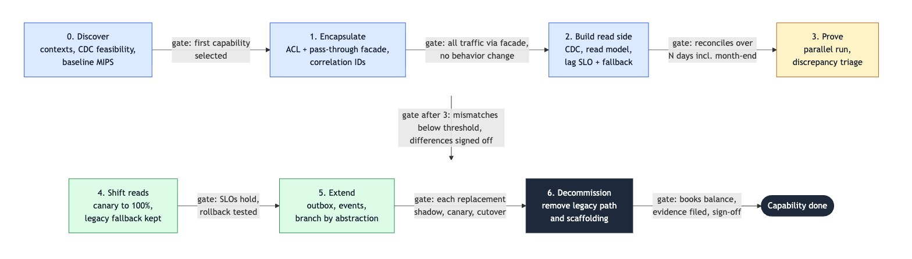

<!-- DZone rejects AI-written text: the author must rewrite this draft in his own words before submitting. -->

<!--
DZone submission metadata
TL;DR: Treat the coexistence period of a core banking modernization as something you govern: phases with exit criteria as gates, one writer per stage, reconciliation as the cutover gate and a small set of metrics.
Article type: Analysis
Summary (meta description): A governance model for the coexistence period of a mainframe modernization: roles, phase gates, staged data ownership, reconciliation and metrics for banks.
Primary zone: Software Design and Architecture. Additional zones: Microservices, Java, DevOps.
Tags: legacy-modernization, strangler-fig, mainframe, software-architecture, data-migration, governance
-->

# Legacy modernization: governing the coexistence period


**Author**: Wallace Espindola, Solution Architect
**Email**: <wallace.espindola@gmail.com>
**LinkedIn**: <https://www.linkedin.com/in/wallaceespindola/>
**GitHub**: <https://github.com/wallaceespindola/>
**Companion repo**: <https://github.com/wallaceespindola/legacy-modernization-patterns>

---

Most core banking modernizations that follow the Strangler Fig approach spend years in a state nobody designed on purpose. Part of the traffic goes to new services, part still hits COBOL programs behind CICS, a CDC pipeline keeps a read model fed and a reconciliation job runs every night to check that both sides agree. That middle state is the coexistence period. It's where the risk sits, and during the transition it carries a large share of the run cost, because you pay for both stacks and for the scaffolding between them.

The patterns for that period are well documented. Martin Fowler's [Strangler Fig Application](https://martinfowler.com/bliki/StranglerFigApplication.html) (the current page is dated 22 August 2024) and [Patterns of Legacy Displacement](https://martinfowler.com/articles/patterns-legacy-displacement/) by Ian Cartwright, Rob Horn and James Lewis (first published 20 July 2021) cover the technical moves. What's less written down is the governance: who decides when a route flips, what evidence a cutover needs, who owns the data at each stage and how you notice that the "temporary" architecture has become permanent.

This article is about that governance side. It's a pattern guide and a proposal, built on the catalog and the Java examples in the [companion repository](https://github.com/wallaceespindola/legacy-modernization-patterns). I don't have adoption numbers from a live rollout, and I won't invent any. If you want the earlier, AI-assisted discovery angle on the same problem, I covered it in [Stop rewriting legacy systems, use AI to understand them first](https://dev.to/wallaceespindola/stop-rewriting-legacy-systems-use-ai-to-understand-them-first-21ba). Here I stay with process: roles, gates, data ownership, reconciliation, metrics and the ways it goes wrong.

## The model in one paragraph

Modernization is decided per capability, one capability at a time. For each capability (account inquiry, interest, notifications, posting), the program moves through seven phases, and each phase ends with an exit criterion that works as a gate: the next phase starts only when the evidence for the previous one is filed and signed. Data ownership moves in stages with exactly one writer at every stage, and the other side gets data through CDC or a reverse-sync path, never through dual writes from application code. Reconciliation of balances and positions between the two stores is the cutover gate. Passing tests alone don't open it. And every piece of transitional architecture has a removal date on the day it's created.

Underneath all of it, rollback stays a routing change for as long as possible. Once a new service owns writes, rollback also needs data to flow back to legacy, which is why the ownership transfer is the most guarded step in the whole program.

## Roles and decision rights

Coexistence spans two technology stacks, two operations teams and usually two sets of people who have never worked together. Without explicit decision rights, every incident turns into "I thought the other side checked that". These are the roles I'd name in a program charter:

- **Solution architect:** owns the target design, the phase plan and the exit criteria. Records each pattern choice as an ADR, because auditors and regulators ask _why_ years later. Owns the decommission plan for every transitional component.
- **Product or business owner:** owns the capability and its value per phase (MIPS/MSU reduction, time to market, risk reduction). Signs the business side of every cutover. Funding tends to stop mid-strangle when nobody can show value per phase, so this role keeps the business case current.
- **Risk and compliance:** defines what counts as audit evidence, signs cutovers that move data ownership and checks regulatory alignment. In the EU that includes [DORA (Regulation (EU) 2022/2554)](https://www.eiopa.europa.eu/digital-operational-resilience-act-dora_en), which applies from 17 January 2025 and covers operational resilience and ICT third-party risk. Data lineage for risk reporting (BCBS 239) and PCI DSS scope for card data come up in the same reviews.
- **Operations (both stacks):** own the SLOs, the CDC lag alerts, the reconciliation break queue and the rollback drill. They run the coexistence, so they get a veto on any gate that adds an unmonitored component.
- **Mainframe engineers:** own legacy behavior, copybooks, batch windows and the CICS side of each interception point. They are also the people who know which "bugs" downstream systems depend on.
- **Modern engineers:** own the new services, the anti-corruption layer, the read model and the comparison tooling for parallel runs.

Pair the last two on purpose. Legacy knowledge has to move before people retire, and a team aligned to a bounded context (Conway's Law applies here as much as anywhere) is easier to govern than a "mainframe team" handing tickets to a "cloud team".

The table below maps who signs which gate. R is responsible for producing the evidence, A is accountable for the decision, C is consulted.

| Gate | Architect | Business owner | Risk and compliance | Operations | Mainframe eng. | Modern eng. |
| --- | --- | --- | --- | --- | --- | --- |
| First capability selected | R/A | C | C | C | C | C |
| Facade carries all traffic, no behavior change | A | | | C | R | R |
| Read model reconciles with legacy | A | | C | C | C | R |
| Parallel-run mismatches explained | A | C | C | | R | R |
| Reads shifted to 100% | C | A | | R | | R |
| Write ownership transferred | C | A | A | R | R | R |
| Capability decommissioned | R | A | A | C | R | C |

Two rows carry a double A on purpose. Moving write ownership and switching off the legacy path are the two decisions that are hard to reverse, so business and risk both sign.

## Seven phases, each with a gate

The phases below follow the account modernization example in the repo's context document. The starting point is a COBOL core banking system that stays system of record for ledger posting and settlement, and the first capability to move is Account Inquiry, a supporting domain with low risk. The ledger is the core domain and usually moves last, or stays.



_Figure 1: Phases of one capability with the exit criterion that gates each transition._

### Figure 1 legend

| Color | Meaning |
| --- | --- |
| Blue | Prepare and build scaffolding (no customer-visible change) |
| Yellow | Prove equivalence |
| Green | Move traffic or ownership |
| Dark | Remove scaffolding and close the capability |

Here's what each gate asks for:

| Phase | Work | Exit criterion (the gate) |
| --- | --- | --- |
| 0. Discover | Event Storming, context map, dependency analysis, CDC feasibility per data store, baseline MIPS, latency and error rates | Bounded contexts agreed; first capability selected |
| 1. Encapsulate | ACL over legacy account functions, facade installed as a pass-through (100% legacy), correlation IDs end to end | All channel traffic flows through the facade with no behavior change |
| 2. Build read side | CDC to translation to read model, pending vs posted modeled, lag SLO and fallback-to-legacy route | Read model reconciles with legacy within tolerance over N business days, including month-end |
| 3. Prove | Parallel run on balance and inquiry responses, discrepancy triage | Mismatch rate below the agreed threshold; every known difference explained and signed off |
| 4. Shift reads | Canary per channel or segment up to 100%, legacy path kept as fallback | SLOs hold at full traffic; rollback tested |
| 5. Extend | Outbox and events for newly owned events, Branch by Abstraction for selected calculations | Each replacement passes its own shadow, canary and cutover |
| 6. Decommission | Remove the legacy path, ACL pieces and transitional pipelines for the capability | Reconciliation clean, audit evidence filed, explicit business and risk sign-off |

Four rows in that table need more explanation than the table gives.

**N business days, including month-end.** The context file leaves N open, and so do I. It's a number your risk owner sets, and it has to include at least one month-end, because that's where batch interest accrual, statements and settlement files run. Add quarter-end and year-end to the window for capabilities that touch them. "Equivalent" systems tend to diverge on calendars: cut-off times, holidays and leap years.

**The agreed threshold.** Same thing. Set it before the parallel run starts, write it into the gate and don't negotiate it down after you see the first results. Every explained difference goes on a known-difference allowlist with a sign-off, and unexplained ones block the gate.

**Phase 1 is a pass-through on purpose.** Installing the facade early with 100% of traffic going to legacy can look like ceremony, but it proves the interception point works, gives you correlation IDs across both worlds before anything moves and later lets you flip routes per operation, per channel or per customer segment without touching clients.

**Phase 5 repeats the gates.** Each new replacement inside the capability (an interest calculation behind Branch by Abstraction, a newly owned event) goes through its own shadow, canary and cutover. A capability isn't "in phase 5" as a whole. Its parts are, each at its own stage.

## Staged data ownership transfer, one writer at a time

Moving code is the easy part. Moving the authoritative copy of the data is where programs get hurt, and it's also the part with the weakest governance in most plans I've read: a single line in a roadmap that says "migrate data".

In the charter I'd write one rule: never dual-write from application code to both stores. Exactly one system owns writes at any moment. A partial failure in a dual write guarantees divergence, and then reconciliation is cleaning up a design flaw instead of catching edge cases.


_Figure 2: Data ownership stages with the gate between each stage and the rollback path from stage 3._

### Figure 2 legend

| Element | Meaning |
| --- | --- |
| Indigo box | Legacy is the single writer |
| Green box | New service is the single writer |
| Solid arrow | Forward transition, labeled with its gate |
| Dashed arrow | Rollback path, which needs data to flow back |

For governance, the stage 2 to stage 3 transition matters most. Up to stage 2, rollback is a routing change: flip the facade back and legacy carries on, because it never stopped owning the data. From stage 3 on, rollback means handing ownership back to legacy and making sure every write the new service accepted flows back, which is what the reverse-sync path is for. So that gate asks for more than the others:

- shadow computation reconciled cleanly over the agreed window;
- reverse sync (reverse CDC or an ACL write-back) tested end to end, including the rollback direction;
- a rehearsed rollback, with operations owning the runbook;
- sign-off from both the business owner and risk.

Stage 4 has its own trap. After the new service owns writes, legacy batch jobs, reports and regulatory feeds still read the legacy store. Those consumers have to be migrated before you can retire the reverse sync, and they're easy to forget because nobody on the modernization team calls them. Inventory them in phase 0, while there is still time to plan for them.

## Reconciliation is the cutover gate

In banking, a cutover is gated by reconciliation and audit evidence. Tests are necessary, but they prove the code does what the team thinks it should. Reconciliation proves the books balance against the system that has been right for decades.

I'd treat reconciliation as a product with an owner and a backlog. Concretely:

- **Scheduled and automated:** balances and positions compared between the legacy store and the new store on a fixed cadence, with tolerance rules defined up front.
- **Break management:** each break gets a category, an owner and a time to resolve. The break rate is one metric and the time to resolve is another.
- **Pending vs posted:** many cores memo-post during the day and hard-post in the end-of-day batch. CDC sees both. If the read model doesn't model pending and posted explicitly, reconciliation will report breaks that are really timing, and the team learns to ignore the report, which is worse than having no report at all.
- **Evidence trail:** the reconciliation reports for the gate window are what risk and compliance file as cutover evidence.

The parallel run applies the same discipline to calculations. Comparing old and new outputs needs field mapping, tolerance rules, a known-difference allowlist, a sampling rate and a triage workflow. The usual false mismatches are rounding mode (COBOL `ROUNDED` is half-up by default, Java `BigDecimal` needs an explicit `RoundingMode`), day-count conventions, business date vs system date, time zones and intermediate truncation. The shadow path must not create side effects, so enforce sandboxed stores and stubbed notification and payment adapters through configuration rather than relying on convention.

## When the outcome is unknown, the process has to say so

Governance also has to cover what happens between the gates, when a financial write over an unreliable link times out. A timeout on a posting call means the outcome is unknown. The posting may have landed on the mainframe or not. A blind retry risks a double posting, and giving up risks a lost one.

The `posting` package in the repo shows the shape the process should require. Here's a trimmed version of `examples/account-modernization/src/main/java/com/wallaceespindola/modernization/posting/SafePostingClient.java` (the package line, imports and constructor are left out):

```java
/** Safe posting: on timeout, ask the ledger before retrying, retry once, then reconcile. */
public class SafePostingClient {

    private final PostingGateway gateway;
    private final ReconciliationQueue reconciliation;

    public PostingResult post(PostingRequest request) {
        try {
            return gateway.post(request);
        } catch (PostingTimeoutException timeout) {
            return resolveUnknownOutcome(request);
        }
    }

    private PostingResult resolveUnknownOutcome(PostingRequest request) {
        Optional<PostingResult> alreadyPosted = lookup(request);
        if (alreadyPosted.isPresent()) {
            return alreadyPosted.get();
        }
        try {
            return gateway.post(request);
        } catch (PostingTimeoutException timeout) {
            return lookup(request).orElseGet(() -> park(request));
        }
    }

    private Optional<PostingResult> lookup(PostingRequest request) {
        return gateway.status(request.idempotencyKey())
                .map(status -> new Posted(status.idempotencyKey(), status.reference()));
    }

    private PostingResult park(PostingRequest request) {
        reconciliation.add(request);
        return new Unknown(request.idempotencyKey());
    }
}
```

The code is small, but it encodes three process decisions. The request carries an idempotency key end to end, so the ledger can answer a status inquiry. On timeout the client asks before it retries, and it retries at most once. Anything still unresolved goes to a `ReconciliationQueue` and comes back as an explicit `Unknown` result, never as a guessed success or failure. The governance side is who drains that queue: an operations role with a defined time to resolve, and the queue depth as a metric on the same dashboard as reconciliation breaks.

Retries also have a cost on the mainframe. They raise MIPS/MSU consumption, which is often the billing metric, so retry budgets and rate limiting at the facade belong in the operations runbook too.

## What to measure

A program without signals turns into a schedule. Track these per capability, because a program-level average hides the capability that's stuck:

| Metric | Question it answers | Warning sign |
| --- | --- | --- |
| Share of traffic routed to new services | Is the strangling actually progressing? | Flat for several reporting periods |
| Legacy MIPS/MSU consumed | Is the business case showing up in the bill? | Rising while traffic moves (retries, fan-out, CDC load) |
| CDC lag against its SLO | Can the read side be trusted? | Frequent breaches, fallback to legacy used often |
| Reconciliation break rate and time to resolve | Do the books balance, and how fast are breaks closed? | Breaks accepted as "normal", queue aging |
| Parallel-run mismatch rate | Is the new logic equivalent? | Unexplained mismatches, allowlist growing without sign-off |
| Transitional components still alive | Is the scaffolding being removed? | Count only ever goes up |

The last one is the one I'd put on the steering committee's first slide. The facade, the ACL pieces, the CDC pipelines, the reverse sync and the reconciliation jobs are what Patterns of Legacy Displacement calls [Transitional Architecture](https://martinfowler.com/articles/patterns-legacy-displacement/transitional-architecture.html): software installed to ease the displacement of a legacy system and meant to be removed. Counting them, with a removal date next to each, keeps that "meant to be" honest.

I haven't put target values in the table. Thresholds depend on your volumes, your SLOs and your regulator. The governance point is that each metric has an owner and a warning sign agreed before the phase starts.

## Anti-patterns to watch for in reviews

Most of these show up in a design review long before they show up in production. List them in the program charter so reviewers can name them:

- **Perpetual strangler:** no decommission criteria, so the bank runs and pays for both stacks indefinitely. The transitional components metric exists to catch this.
- **Big-bang data migration disguised as incremental:** code moves capability by capability, but all data moves in one weekend. The staged ownership model is the counter.
- **Dual writes** from application code to legacy and new stores. Divergence on partial failure is a matter of time.
- **Ledger first:** moving the highest-risk, most coupled core domain before the pipeline has been proven on low-risk capabilities.
- **Shared database integration:** new services reading legacy tables directly, bypassing the ACL, which couples them to the physical schema.
- **Leaky ACL:** new APIs and events that expose legacy field names, codes or record layouts.
- **One microservice per COBOL program:** 1980s program boundaries reproduced with network latency added, usually ending as a distributed monolith.
- **Gates negotiated after the fact:** thresholds lowered once the first parallel-run results come in. Nothing in the code shows it, so it's the hardest one to spot from inside the team.

## Trade-offs and when this is too much

This model costs time and money. Each gate needs evidence, each piece of evidence needs someone to produce and file it. Coexistence is the expensive period. Running two stacks plus scaffolding plus reconciliation is not cheap, and the governance adds calendar time on top.

So it doesn't always pay off. Strangler Fig itself is the wrong tool when:

- there is no interception point, no API, queue or data boundary you can put a facade on;
- the system is small enough to replace in one well-tested release, and coexistence would cost more than the cutover;
- you're replacing it with a vendor package, where migration is data and process driven (parallel run and reconciliation still apply);
- the capability is stable, cheap to run and not blocking change, in which case retaining it behind an API is a legitimate outcome.

Inside a strangler program, I'd also scale the gates to the risk. A notifications capability fed by an outbox doesn't need the same sign-off chain as moving write ownership of balances. What I wouldn't relax is the single-writer rule and reconciliation before any ownership transfer. Those two are cheap compared with explaining a divergent ledger to an auditor.

There's also a people cost. Pairing mainframe and modern engineers slows both down at first, and a risk function asked to sign every gate can become the bottleneck. Agree in phase 0 which gates need risk sign-off and which only need them informed.

## Wrapping up

- Much of the risk and a large share of the run cost of a strangler program sit in the coexistence period, so govern it with explicit roles and decision rights.
- Seven phases per capability, each ending with an exit criterion that works as a gate and is signed by named roles.
- Data ownership moves in stages with one writer at every stage. The stage where the new service takes writes gets the strictest gate, because rollback stops being a routing change.
- Reconciliation is the cutover gate, and unknown outcomes on financial writes are parked for reconciliation, never guessed.
- Track a handful of per-capability metrics, and count the transitional components so the strangler doesn't become permanent.

The phase plan, the pattern catalog and the Java examples (including `SafePostingClient` and its tests) are in the [companion repo](https://github.com/wallaceespindola/legacy-modernization-patterns). Adapt the gates and the sign-off table to your own risk function.

How does your organization decide when a capability is really done? I'm curious whether others formalized the gates and decommission criteria or still run on a cutover weekend and good intentions. Let me know in the comments.

**Examples repository:** <https://github.com/wallaceespindola/legacy-modernization-patterns>

Need more tech insights?
Check out my GitHub, LinkedIn, and Speaker Deck.
Happy coding!

Wallace Espindola, Solution Architect

- GitHub: <https://github.com/wallaceespindola/>
- LinkedIn: <https://www.linkedin.com/in/wallaceespindola/>
- Speaker Deck: <https://speakerdeck.com/wallacese>
