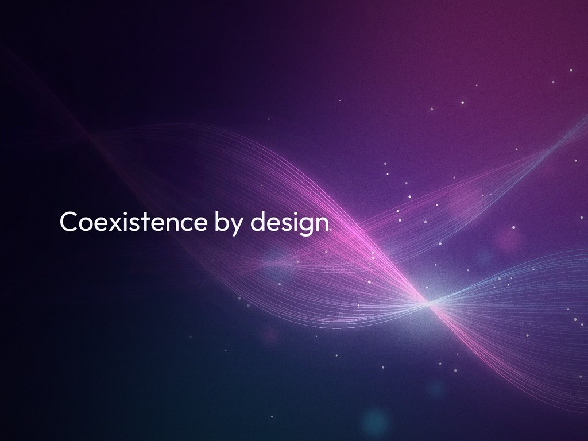

<!--
Meta description: Incremental core banking modernization is mostly coexistence: a pattern system for routing, translation, data movement, proof and resilience that keeps two stacks correct at once.
Tags: legacy modernization, strangler fig, core banking, anti-corruption layer, change data capture, parallel run, DORA, BCBS 239
-->

# Coexistence Is the Architecture: Patterns for Core Banking Modernization

**Key Takeaways**

- In incremental core banking modernization, the Strangler Fig pattern decides where traffic goes, but most of the design work sits in the coexistence period, when the legacy core and the new services run side by side for months or years.
- The patterns that make coexistence safe fall into five concerns (routing, translation, data movement, proof and resilience), and an architecture review can check a migration plan against each of them.
- Moving code is easier than moving the authoritative copy of the data, so write ownership should move in explicit stages with a single writer at every stage and reconciliation as the gate between stages.
- A timeout on a financial write is an unknown outcome rather than a failure, and the safe response is an idempotency key, a status inquiry before any retry and a reconciliation queue for what stays unresolved.
- Regulation such as the EU's Digital Operational Resilience Act and the Basel Committee's BCBS 239 principles turns rollback, exit plans, data lineage and reconciliation evidence into design requirements, and AI tools help most when they generate candidates that deterministic checks then accept or reject.

---

*By Wallace Espindola, Solution Architect · [LinkedIn](https://www.linkedin.com/in/wallaceespindola/) · [GitHub](https://github.com/wallaceespindola/)*

*Companion repository with the pattern catalog, the phased account example and a small Java module that implements the anti-corruption layer, parallel run, outbox and safe posting patterns discussed here: [github.com/wallaceespindola/legacy-modernization-patterns](https://github.com/wallaceespindola/legacy-modernization-patterns)*

---

## Where the usual strangler story stops

The case for incremental replacement of legacy systems is well established. Rewriting a core banking platform in one release concentrates risk in a single cutover weekend, and few banks can accept that. The alternative that most architects reach for is the Strangler Fig pattern: put an interception point in front of the legacy system, build new capabilities behind it and move traffic over one capability at a time until the old system can be switched off.

The usual telling of that story covers the facade and the routing switch. It says less about what happens between the first routed call and the last decommissioned program. During that period, two systems hold overlapping data, process overlapping transactions and answer to the same auditors. A mobile channel may read balances from a new service while ledger posting stays on a COBOL and CICS mainframe. End-of-day batch still runs on the old side. Regulatory reports still read from legacy tables.

This article treats that period as an architecture in its own right. It describes the patterns that make coexistence safe, groups them by the concern each one answers, and looks at three problems that are specific to financial systems: staged transfer of data ownership, the unknown outcome of a timed-out write and the regulatory evidence that a cutover needs. It also covers where AI tools fit and the anti-patterns that show up most often.

The analysis is grounded in an open repository: a pattern catalog for mainframe banking estates, a phased account modernization example and a small Java 21 module whose 36 tests exercise the translation, parallel run, outbox and safe posting patterns. The module is a teaching artifact, not a production system, and this article reports no adoption figures or production outcomes, because none exist for it.

## How the idea developed

The vocabulary used in modernization reviews today came from several sources over about two decades, and most of it was not written with banks in mind.

**Strangler Fig.** Martin Fowler described the idea in a short bliki post titled [Strangler Application](https://martinfowler.com/bliki/OriginalStranglerFigApplication.html) on 29 June 2004, after seeing strangler figs in Queensland rain forests in 2001. He rewrote it as [Strangler Fig Application](https://martinfowler.com/bliki/StranglerFigApplication.html) on 22 August 2024, renaming it to keep the botanical metaphor in view. The central claim has not changed: grow the new system around the edges of the old one and let it take over gradually.

**Anti-Corruption Layer.** Eric Evans introduced the anticorruption layer in *Domain-Driven Design: Tackling Complexity in the Heart of Software* (Addison-Wesley, [2003](https://www.oreilly.com/library/view/-/0321125215/)), together with bounded contexts and context maps. The layer translates between a legacy model and a new one so that old assumptions do not leak into the new design. Context maps also tell an architect where such layers are needed: wherever a new context would otherwise conform to a legacy one.

**Characterization tests.** Michael Feathers named characterization tests in *Working Effectively with Legacy Code* ([Prentice Hall, September 2004](https://www.oreilly.com/library/view/working-effectively-with/0131177052/)). They record what a system does today, including behavior that is arguably wrong but that downstream systems rely on, before anyone changes it. In a migration, they become the baseline that a parallel run compares against.

**Sagas, outbox and idempotent consumers.** Hector Garcia-Molina and Kenneth Salem defined [sagas](https://doi.org/10.1145/38713.38742) at SIGMOD in 1987 as long-lived transactions broken into steps with compensating actions. Chris Richardson's *Microservices Patterns* ([Manning, October 2018](https://www.manning.com/books/microservices-patterns)) and his [microservices.io](https://microservices.io/patterns/data/transactional-outbox.html) catalog brought sagas, the transactional outbox and the idempotent consumer into common use for service architectures. The outbox commits a state change and the event that describes it in one local transaction. The relay that publishes the event can deliver it more than once, so consumers must deduplicate.

**Branch by Abstraction.** Fowler's [bliki entry](https://martinfowler.com/bliki/BranchByAbstraction.html) (January 2014) credits Paul Hammant with the name and Stacy Curl with the technique: put an abstraction in front of an implementation, then swap the implementation behind it. It applies where a gateway cannot isolate the logic, such as an interest calculation called from inside a larger program.

**Patterns of Legacy Displacement.** Ian Cartwright, Rob Horn and James Lewis published [Patterns of Legacy Displacement](https://martinfowler.com/articles/patterns-legacy-displacement/) on martinfowler.com, first on 20 July 2021 with revisions through 5 March 2024. The series names patterns that earlier writing left implicit, including Transitional Architecture, Legacy Mimic, Divert the Flow and [Event Interception](https://martinfowler.com/articles/patterns-legacy-displacement/event-interception.html), which intercepts updates to system state rather than calls. Transitional Architecture is the closest existing name for the subject of this article: software built to support the migration and removed when it is done.

Each of these sources covers one part of the problem. Banking adds the requirement that the parts work together while money moves, under audit.

## Coexistence as a pattern system

A useful way to review a modernization plan is to ask five questions of every capability in scope. Who answers a given call? What does the legacy data mean? Which system owns each record? How do we know the new behavior is equivalent? What happens when a call fails halfway? Each question maps to a group of patterns.

*Figure 1: Pattern fit map by concern. A plan that leaves a row empty usually has a gap there.*

### Routing: who answers the call

The facade is the interception point Strangler Fig needs. On a mainframe, the usual options are an API gateway in front of channel traffic with mainframe functions exposed as REST (for example through [IBM z/OS Connect](https://www.ibm.com/docs/SS4SVW_3.0.0/overview/what_is.html)), interception on IBM MQ queues, event interception through change data capture (CDC), or file interception for batch jobs. Two design choices matter more than the product. The facade should be installed early as a pass-through that sends all traffic to legacy, so that later route changes do not require client changes. And routing should be decided per operation, such as a balance inquiry, rather than per screen or per COBOL program. With both in place, rollback becomes a routing change instead of a deployment.

### Translation: what the legacy data means

The anti-corruption layer (ACL) handles the mechanical conversions (EBCDIC to UTF-8, packed decimal to exact decimal types, fixed-width copybook records to typed objects, return codes to domain errors). The harder part is semantic. A legacy "balance" field can hold a ledger balance or a memo-posted one depending on a record type flag. The `AccountTranslator` class in the companion module makes that distinction explicit, mapping the flag to a `POSTED` or `PENDING` balance type and turning return codes into "found", "not found" and "blocked" results. An ACL should stay one per bounded context, carry versioned contracts and contain no business logic beyond translation. Otherwise it becomes a new monolith in the middle of the estate.

### Data movement: who owns each record

CDC feeds a read-optimized model from the legacy store, and Command Query Responsibility Segregation (CQRS) lets that model serve high-volume inquiries while the mainframe ledger stays the write model. Raw CDC records are shaped like the legacy schema, so they need their own translation step before they reach the new model. Many cores memo-post during the day and hard-post in the end-of-day batch, and a read model that does not distinguish pending from posted entries will show balances that jump. Where the new side starts to own events, the outbox and an idempotent consumer carry them reliably. Once the new side owns writes, reverse synchronization keeps legacy batch, reports and regulatory feeds supplied until they move too.

### Proof: is the new behavior equivalent

Characterization tests pin current behavior. A parallel run executes legacy and new logic on the same inputs and compares the results. The companion module's `ParallelRun` class always serves the legacy result and records each comparison in a triage category: match, rounding, within tolerance, day-count difference or unexplained. The categories reflect common false mismatches in banking code: COBOL `ROUNDED` rounds half-up by default while Java's `BigDecimal` needs an explicit rounding mode, and a legacy 30-day month disagrees with actual-day counts in every month that is not 30 days long. Reconciliation then compares balances and positions between the two stores on a schedule, with a process for resolving breaks. In banking, the cutover gate is a clean reconciliation, in addition to a passing test suite.

### Resilience: what happens when a call fails

Circuit breakers and bulkheads (popularized by Michael Nygard's *Release It!*) protect modern services from a slow mainframe dependency, and separate pools per dependency keep a long batch window on one subsystem from starving inquiries on another. Resilience also has to protect the mainframe: retries and fan-out raise capacity consumption, which on many mainframes is also the billing metric, so the facade needs rate limits and retry budgets. Correlation IDs propagated from the channel through the facade, the services and the CICS transaction or MQ message are what make incident triage across both stacks possible. The hardest resilience problem, the timed-out financial write, gets its own section below.

## Data ownership transfer in stages

Moving code is the easier half of modernization. Moving the authoritative copy of the data is harder, and most of the coexistence patterns exist either to move ownership safely or to live with split ownership for a while.

The rule that keeps this tractable is a single writer at every stage. Application code should never write to both the legacy store and the new store, because a partial failure between the two writes produces divergence that nobody can detect until reconciliation fails. Instead, one system owns writes at any given moment and the other receives data through CDC or a synchronization path.

![Data ownership transfer in four stages with gates. Stage 1: legacy writes, the new side holds a CDC read copy. Gate: the read model reconciles over N business days including month-end. Stage 2: legacy writes, the new side computes in shadow. Gate: mismatches explained and signed off, rollback tested. Stage 3: the new side writes, legacy holds a reverse-sync copy; rollback from here needs data flowing back to legacy. Gate: batch, reports and regulatory feeds migrated. Stage 4: legacy consumers moved, sync and legacy path retired.](diagrams/ownership-transfer.jpg)

*Figure 2: Ownership moves in four stages, and each transition has an explicit gate.*

In the first stage, legacy owns writes and the new service reads a copy built from CDC. The gate is reconciliation of that copy against legacy over a defined number of business days, including a month-end, because month-end processing is where many differences surface. In the second stage, the new side computes results in shadow and a parallel run compares them. The gate is a mismatch rate below an agreed threshold, with every known difference explained and signed off. The third stage is the real transfer: the new service owns writes and legacy becomes a read copy fed by reverse synchronization. Rollback from this point is no longer just a routing change, because data written on the new side must flow back to legacy before legacy can take over again. The final stage removes reverse synchronization and the legacy path once every legacy consumer (batch jobs, statements, regulatory feeds) has moved.

The stages make a common anti-pattern visible: incremental code migration combined with a big-bang data migration. If every capability's data moves in one weekend, the plan is a big-bang migration, however incremental the code changes look.

## The unknown outcome on financial writes

Most resilience guidance treats a timeout as a failure and suggests a retry. For a posting or payment call, that is unsafe. A timeout means the caller does not know whether the ledger applied the posting. Retrying blindly can post twice, and giving up can lose a posting the ledger actually applied.

The safe approach treats the timeout as an unknown outcome and resolves it. Each request carries an idempotency key from end to end. On timeout, the client asks the ledger for the status of that key before doing anything else. If the posting exists, the client returns it. If it does not, one retry with the same key is safe, because the ledger deduplicates by key. If the retry also times out and a second inquiry still finds nothing, the request goes to a reconciliation queue and the caller receives an explicit "unknown" result.

*Figure 3: Resolving a timed-out posting. No path retries without a status inquiry first, and no path guesses.*

The companion module's `SafePostingClient` follows this flow, and its result type has only two cases, posted with a ledger reference or unknown with the idempotency key. In this design, "unknown" is a first-class result. Callers, user interfaces and operations staff have to handle it, which is uncomfortable, but it is a true statement about the system. Two prerequisites sit outside the client: the ledger side must deduplicate by key and must answer status inquiries. On a mainframe, that often means new CICS logic or a lookup table maintained in the same unit of work as the posting, and it should be planned into the first phases rather than discovered during the first incident.

Sagas do not remove this problem. A saga coordinates multi-step processes, such as loan origination, through local transactions and compensations. In accounting, compensation is a reversal entry rather than a rollback, so it fits financial steps when the ledger supports reversals. A saga is not a substitute for atomic ledger posting, and each of its steps still needs the unknown-outcome handling described here.

## Regulatory forces

Two regulatory frameworks shape how banks in their scope can run a coexistence period, and both turn operational practices into evidence requirements.

The EU's [Digital Operational Resilience Act](https://eur-lex.europa.eu/eli/reg/2022/2554/oj) (Regulation (EU) 2022/2554) has applied since 17 January 2025. It covers ICT risk management, incident reporting, resilience testing and ICT third-party risk, including documented exit strategies for arrangements that support critical or important functions. For a modernization program, that has concrete consequences. A tested rollback path counts as part of operational resilience. A coexistence architecture that adds a new cloud provider adds third-party risk that needs an exit plan of its own. And incidents during cutover fall under the same reporting regime as any other incident.

The Basel Committee's [Principles for effective risk data aggregation and risk reporting](https://www.bis.org/publ/bcbs239.htm), published in January 2013 and commonly called BCBS 239, apply to systemically important banks. The principles cover governance, data architecture, the accuracy, integrity, completeness and timeliness of risk data, and risk reporting. During coexistence, risk data is assembled from two stacks at once. Data lineage across the legacy store, CDC pipelines, read models and reverse synchronization therefore has to be documented, and reconciliation results become evidence that aggregated figures are accurate.

The practical response is to treat audit evidence as an output of the architecture. Architecture decision records explain why each pattern was chosen, which matters when auditors ask years later. Parallel-run reports, reconciliation break logs and cutover sign-offs are filed per capability. A cutover is approved by business and risk owners on that evidence, not by the team that built the new service.

## Where AI fits, with guardrails

Generative AI tools have found a place in legacy modernization, mostly in understanding the existing system before anyone changes it. That shift was the subject of an [earlier article](https://dev.to/wallaceespindola/stop-rewriting-legacy-systems-use-ai-to-understand-them-first-21ba) by the same author. In the pattern system above, the useful applications are specific:

- **Discovery:** mapping dependencies across programs, copybooks and JCL flows, and suggesting candidate bounded contexts.
- **Translation:** proposing semantic mappings for the ACL, and generating schemas or typed records from copybooks, including `REDEFINES` and `OCCURS DEPENDING ON` handling.
- **Proof:** generating characterization test candidates from production-like inputs, and clustering parallel-run mismatches by likely root cause so that experts review categories rather than rows.
- **Documentation recovery:** explaining programs and data lineage to engineers who did not write them.

Each of these produces candidates, and the guardrail is that candidates do not reach production without a deterministic check or an expert decision. Extracted business rules should cite the source program, paragraph and line so that a reviewer can verify them. Generated tests must be validated against real legacy outputs, not against generated code, or they will encode the tool's own misunderstanding. Line-by-line COBOL-to-Java translation tends to preserve legacy structure in a new language, which defeats the purpose of the ACL and the new domain model. Core banking source is sensitive, so tools should run under approved deployment models, and production data should never be pasted into prompts. Prompt and model versions, along with human sign-offs, belong in the same audit trail as any other tool in the change process. Vendor capabilities in this area change quickly, so claims about specific products are best evaluated against a bank's own code.

## Risks and anti-patterns

The coexistence architecture has costs of its own. Facades, CDC pipelines, reconciliation jobs and reverse synchronization must be built, operated and eventually removed. During coexistence, the bank pays for mainframe capacity and new infrastructure at the same time, and the period is often the most expensive part of the program. If the business case does not show value per phase, funding can stop partway through and leave both stacks in place.

Several anti-patterns recur in modernization reviews:

- **Perpetual strangler:** no decommission criteria, so both stacks run indefinitely. Tracking the number of transitional components still alive, per capability, keeps this visible.
- **Dual writes:** application code writing to both stores, which guarantees divergence on partial failure.
- **Shared database integration:** new services reading legacy tables directly and bypassing the ACL, which couples them to the physical schema.
- **Leaky ACL:** legacy field names, codes or record shapes appearing in new APIs and events.
- **One microservice per COBOL program:** reproducing the structure of 1980s batch and online splits, with network latency added. The result is often a distributed monolith.
- **Ledger first:** migrating the most coupled, highest-risk domain before the pipeline has been proven on low-risk capabilities such as account inquiry or notifications.
- **Big-bang data migration disguised as incremental:** code moves one capability at a time while all data moves at once.

Strangler Fig is also not always the right choice. It needs an interception point (an API, a queue or a data boundary), and some estates have none. A small system that can be replaced in one well-tested release may cost less to cut over than to run in coexistence. A move to a vendor package is driven by data and process migration, although parallel run and reconciliation still apply. And a capability that is stable, cheap to run and not blocking change can be retained and encapsulated behind an API. Modernization is a decision per capability, and "retain" is a legitimate outcome.

## Conclusion

Strangler Fig describes how traffic moves from a legacy core to new services. The work that determines whether a bank can do that safely happens during coexistence: translation that keeps legacy semantics out of the new model, data ownership that moves in gated stages with one writer at a time, parallel runs and reconciliation that prove equivalence, and resilience patterns that treat a timed-out write as unknown rather than failed. Regulation adds the requirement that every one of those steps leaves evidence behind.

A capability is modernized when the new system owns its data, the books balance and the legacy path has been switched off, not when the first route is flipped. Which of the five concerns gets the least design attention in the modernization programs you have seen?

## References

- Martin Fowler, [Strangler Application (original post)](https://martinfowler.com/bliki/OriginalStranglerFigApplication.html), martinfowler.com, June 2004
- Martin Fowler, [Strangler Fig Application](https://martinfowler.com/bliki/StranglerFigApplication.html), martinfowler.com, August 2024
- Ian Cartwright, Rob Horn and James Lewis, [Patterns of Legacy Displacement](https://martinfowler.com/articles/patterns-legacy-displacement/), martinfowler.com, July 2021, revised March 2024
- Ian Cartwright, Rob Horn and James Lewis, [Event Interception](https://martinfowler.com/articles/patterns-legacy-displacement/event-interception.html), martinfowler.com, March 2024
- Martin Fowler, [Branch by Abstraction](https://martinfowler.com/bliki/BranchByAbstraction.html), martinfowler.com, January 2014
- Eric Evans, [Domain-Driven Design: Tackling Complexity in the Heart of Software](https://www.oreilly.com/library/view/-/0321125215/), Addison-Wesley, 2003
- Michael Feathers, [Working Effectively with Legacy Code](https://www.oreilly.com/library/view/working-effectively-with/0131177052/), Prentice Hall, 2004
- Hector Garcia-Molina and Kenneth Salem, [Sagas](https://doi.org/10.1145/38713.38742), Proceedings of ACM SIGMOD, 1987
- Chris Richardson, [Microservices Patterns](https://www.manning.com/books/microservices-patterns), Manning, 2018
- Chris Richardson, [Pattern: Transactional outbox](https://microservices.io/patterns/data/transactional-outbox.html), microservices.io
- Michael T. Nygard, [Release It!](https://pragprog.com/titles/mnee2/release-it-second-edition/), Pragmatic Bookshelf
- European Union, [Regulation (EU) 2022/2554 on digital operational resilience for the financial sector (DORA)](https://eur-lex.europa.eu/eli/reg/2022/2554/oj)
- Basel Committee on Banking Supervision, [Principles for effective risk data aggregation and risk reporting (BCBS 239)](https://www.bis.org/publ/bcbs239.htm), January 2013
- IBM, [What is IBM z/OS Connect?](https://www.ibm.com/docs/SS4SVW_3.0.0/overview/what_is.html)
- Companion repository with the pattern catalog, the phased example and the Java module: [github.com/wallaceespindola/legacy-modernization-patterns](https://github.com/wallaceespindola/legacy-modernization-patterns)

## About the author

**Wallace Espindola, Solution Architect**

Wallace Espindola is a senior software engineer and solution architect working across Java/Spring Boot and Python/FastAPI backends, cloud-native microservices on Kubernetes and OpenShift, and system architecture design. He maintains the open-source repository behind this article, which catalogs the patterns that support Strangler Fig in core banking modernization and implements several of them in a small, tested Java module.

Contact: [LinkedIn](https://www.linkedin.com/in/wallaceespindola/) · [GitHub](https://github.com/wallaceespindola/)

---

**AI disclosure**: This article was drafted with AI assistance (Claude) for research support, outlining, drafting and editing, based on the author's own pattern catalog and repository. Dates, regulatory details and quotes were checked against the cited sources.

**Publishing note**: This article is submitted for InfoQ's 4-week exclusive publishing window. It will not be cross-posted to other platforms until that window closes.

Examples repository: <https://github.com/wallaceespindola/legacy-modernization-patterns>

Need more tech insights?
Check out my GitHub, LinkedIn, and Speaker Deck.
Happy coding!

Wallace Espindola, Solution Architect

- GitHub: <https://github.com/wallaceespindola/>
- LinkedIn: <https://www.linkedin.com/in/wallaceespindola/>
- Speaker Deck: <https://speakerdeck.com/wallacese>
