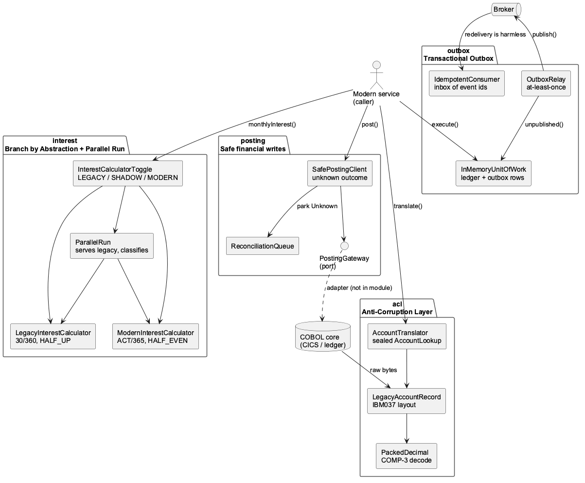
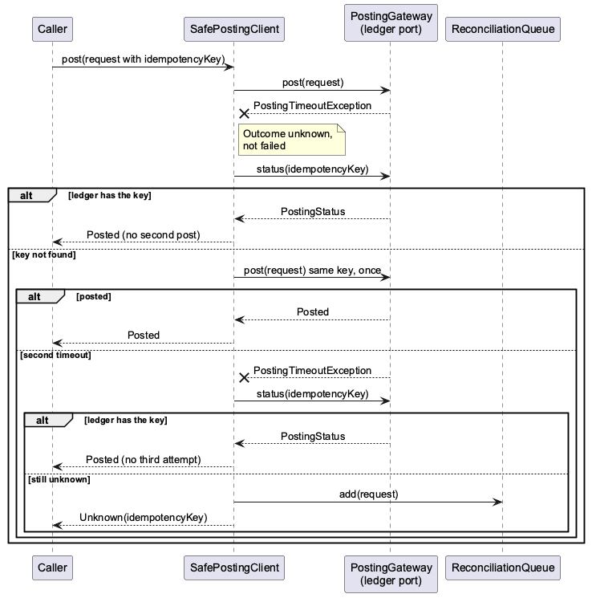

<!-- JAVAPRO: tell the editor the draft is visible in the public repo, or make the article private until publication. -->


# From COBOL behavior to tested Java: ACL, parallel run, safe posting

**By Wallace Espindola, Solution Architect**
<wallace.espindola@gmail.com> | [LinkedIn](https://www.linkedin.com/in/wallaceespindola/) | [GitHub](https://github.com/wallaceespindola/)

*I wrote this article with AI assistance, then reviewed, fact-checked and edited it myself. It is written for JAVAPRO and has not been published on any other site. The draft lives in the public examples repository.*

---

## Abstract

A Strangler Fig migration of a COBOL core replaces one capability at a time, and the hard part is the period when old and new coexist. This article walks through a Java 25 module with four patterns for that period: an anti-corruption layer for an EBCDIC record, Branch by Abstraction with a parallel run, a transactional outbox with an idempotent consumer and a posting client that treats a timeout as an unknown outcome. For each package I show the code, the design choice and the tests.

---

## Introduction

A bank that strangles its core one capability at a time ends up with Java services that read COBOL records, recompute numbers the mainframe already computes, publish events and post money over links that sometimes time out. Each piece is a few dozen lines and easy to get subtly wrong. This article is for the people who will read the diff.

The [legacy-modernization-patterns](https://github.com/wallaceespindola/legacy-modernization-patterns) repository holds the series context and a Maven module, `examples/account-modernization/`, with four packages: `acl`, `interest`, `outbox` and `posting`. It is plain Java 25 with JUnit 5 and AssertJ, 36 tests, no Spring and no database, so `mvn verify` runs offline in seconds. The code and the copybook layout are illustrative, made up for the example.

For the step before any of this, understanding what the legacy system does, see my earlier [Dev.to piece](https://dev.to/wallaceespindola/stop-rewriting-legacy-systems-use-ai-to-understand-them-first-21ba).

## Design choices and why

**Records and sealed interfaces for outcomes:** a legacy return code or an uncertain write becomes a closed set of types. The compiler checks a `switch` over a sealed interface for exhaustiveness, so a new outcome breaks the build.

**No framework, no database:** the patterns are about ordering, atomicity and semantics. An in-memory unit of work shows the outbox contract more plainly than `@Transactional` would, and keeps tests deterministic.

**Ports where a framework would plug in:** in a hexagonal layout, `PostingGateway` and `Publisher` are ports. A Spring Boot service would add the adapters: a z/OS Connect or IBM MQ client behind `PostingGateway`, a Kafka or JMS template behind `Publisher`, a JDBC repository behind the unit of work and configuration that sets the toggle mode. The domain code in the module would not change.



## Package acl: reading the copybook without inheriting it

The anti-corruption layer has two jobs: parse the bytes, then translate the meaning. The module keeps them in separate classes. Parsing starts with COMP-3, where each byte holds two decimal digits and the last nibble is the sign. Here is `acl/PackedDecimal.java`, with the package and imports trimmed:

```java
/** Anti-Corruption Layer: decodes COBOL COMP-3 packed decimals into BigDecimal. */
public final class PackedDecimal {

    private static final int SIGN_POSITIVE_C = 0xC;
    private static final int SIGN_POSITIVE_F = 0xF;
    private static final int SIGN_NEGATIVE = 0xD;
    private static final int MAX_DIGIT = 9;

    private PackedDecimal() {
    }

    public static BigDecimal decode(byte[] bytes, int scale) {
        if (bytes == null || bytes.length == 0) {
            throw new IllegalArgumentException("Empty packed decimal");
        }
        BigInteger digits = BigInteger.ZERO;
        int last = bytes.length - 1;
        for (int i = 0; i <= last; i++) {
            digits = append(digits, bytes[i] >> 4 & 0xF);
            if (i < last) {
                digits = append(digits, bytes[i] & 0xF);
            }
        }
        boolean negative = isNegative(bytes[last] & 0xF);
        return new BigDecimal(negative ? digits.negate() : digits, scale);
    }

    private static BigInteger append(BigInteger digits, int nibble) {
        if (nibble > MAX_DIGIT) {
            throw new IllegalArgumentException("Invalid packed digit nibble: " + nibble);
        }
        return digits.multiply(BigInteger.TEN).add(BigInteger.valueOf(nibble));
    }

    private static boolean isNegative(int signNibble) {
        return switch (signNibble) {
            case SIGN_POSITIVE_C, SIGN_POSITIVE_F -> false;
            case SIGN_NEGATIVE -> true;
            default -> throw new IllegalArgumentException("Invalid packed sign nibble: " + signNibble);
        };
    }
}
```

The scale is a parameter because COMP-3 has no decimal point. The implied decimal point (`V99`) lives in the copybook's PIC clause, not in the bytes. Every invalid nibble throws, because a decoder that quietly maps `0xA` to zero produces a plausible wrong balance.

The record itself is fixed width: a 10-byte account id, a 1-byte type flag, a 7-byte packed balance and a 2-byte return code, all in EBCDIC. Here is `acl/LegacyAccountRecord.java`, imports trimmed:

```java
/** Anti-Corruption Layer: the fixed-width EBCDIC copybook record, parsed but not yet interpreted. */
public record LegacyAccountRecord(String accountId, char typeFlag, BigDecimal balance, String returnCode) {

    public static final Charset EBCDIC = Charset.forName("IBM037");
    public static final int ID_LENGTH = 10;
    public static final int BALANCE_LENGTH = 7;
    public static final int RETURN_CODE_LENGTH = 2;
    public static final int LENGTH = ID_LENGTH + 1 + BALANCE_LENGTH + RETURN_CODE_LENGTH;
    private static final int BALANCE_SCALE = 2;

    public static LegacyAccountRecord parse(byte[] raw) {
        if (raw == null || raw.length != LENGTH) {
            throw new LegacyTechnicalException("Unexpected record length, expected " + LENGTH);
        }
        int typeAt = ID_LENGTH;
        int balanceAt = typeAt + 1;
        int codeAt = balanceAt + BALANCE_LENGTH;
        try {
            return new LegacyAccountRecord(
                    new String(raw, 0, ID_LENGTH, EBCDIC).trim(),
                    new String(raw, typeAt, 1, EBCDIC).charAt(0),
                    PackedDecimal.decode(Arrays.copyOfRange(raw, balanceAt, codeAt), BALANCE_SCALE),
                    new String(raw, codeAt, RETURN_CODE_LENGTH, EBCDIC));
        } catch (IllegalArgumentException e) {
            throw new LegacyTechnicalException("Corrupt legacy record", e);
        }
    }
}
```

The record keeps the legacy vocabulary on purpose (`typeFlag`, `returnCode`), because interpretation belongs to the translator. IBM037 is in the JDK's extended encoding set, which [Oracle's supported encodings page](https://docs.oracle.com/en/java/javase/21/intl/supported-encodings.html) places in the `jdk.charsets` module. A trimmed `jlink` image without that module fails at class initialization, so add it explicitly.

Interpretation happens in the translator. `AccountLookup` is a sealed interface with three records, `Found(AccountBalance)`, `NotFound(accountId)` and `Blocked(accountId)`, and the type flag becomes an explicit `BalanceType`. Here is `acl/AccountTranslator.java`, package and imports trimmed:

```java
/** Anti-Corruption Layer: semantic translation of a raw legacy record into a domain result. */
public class AccountTranslator {

    private static final String OK = "00";
    private static final String NOT_FOUND = "04";
    private static final String BLOCKED = "08";
    private static final char LEDGER_FLAG = 'L';
    private static final char MEMO_POSTED_FLAG = 'M';

    public AccountLookup translate(byte[] raw) {
        LegacyAccountRecord record = LegacyAccountRecord.parse(raw);
        return switch (record.returnCode()) {
            case OK -> new Found(new AccountBalance(record.accountId(), record.balance(), typeOf(record.typeFlag())));
            case NOT_FOUND -> new NotFound(record.accountId());
            case BLOCKED -> new Blocked(record.accountId());
            default -> throw new LegacyTechnicalException("Legacy return code " + record.returnCode());
        };
    }

    private static BalanceType typeOf(char flag) {
        return switch (flag) {
            case LEDGER_FLAG -> BalanceType.POSTED;
            case MEMO_POSTED_FLAG -> BalanceType.PENDING;
            default -> throw new LegacyTechnicalException("Unknown record type flag " + flag);
        };
    }
}
```

Business outcomes (not found, blocked) are values, and technical failures (unknown code, unknown flag, corrupt bytes) are exceptions. Without the translator, the `'M'` memo-posted flag leaks into every consumer as a magic character. The tests build real EBCDIC bytes with a `RecordBuilder` helper and cover each code, a negative balance, a wrong length and a corrupted packed byte.

## Package interest: Branch by Abstraction and a parallel run

[Branch by Abstraction](https://martinfowler.com/bliki/BranchByAbstraction.html) puts an interface in front of logic that gateway routing can't isolate. Here the seam is the one-method `InterestCalculator` interface. The two implementations differ in day count, intermediate truncation and rounding mode. Here are the method bodies of `interest/LegacyInterestCalculator.java` and `interest/ModernInterestCalculator.java`, trimmed to the methods. In the files, the legacy constants are 30 and 360 days, a work scale of 4 and a result scale of 2. The modern ones are 365 days and a result scale of 2:

```java
    @Override
    public BigDecimal monthlyInterest(BigDecimal balance, BigDecimal annualRate, YearMonth month) {
        BigDecimal raw = balance.multiply(annualRate)
                .multiply(BigDecimal.valueOf(DAYS_IN_MONTH))
                .divide(BigDecimal.valueOf(DAYS_IN_YEAR), WORK_SCALE, RoundingMode.DOWN);
        return raw.setScale(RESULT_SCALE, RoundingMode.HALF_UP);
    }
```

```java
    @Override
    public BigDecimal monthlyInterest(BigDecimal balance, BigDecimal annualRate, YearMonth month) {
        return balance.multiply(annualRate)
                .multiply(BigDecimal.valueOf(month.lengthOfMonth()))
                .divide(BigDecimal.valueOf(DAYS_IN_YEAR), MathContext.DECIMAL128)
                .setScale(RESULT_SCALE, RoundingMode.HALF_EVEN);
    }
```

The legacy version mirrors typical legacy core-banking arithmetic: a 30/360 day count, an intermediate field with four decimals that truncates (`RoundingMode.DOWN`), then `ROUNDED`, which is half-up. The modern version uses actual days over 365, keeps full precision and rounds half-even. Neither is wrong. They are different contracts, and the parallel run exists to make the difference visible before anyone routes money through the new one.

Here is `interest/ParallelRun.java`, trimmed to the comparison and classification logic:

```java
    @Override
    public BigDecimal monthlyInterest(BigDecimal balance, BigDecimal annualRate, YearMonth month) {
        BigDecimal legacyResult = legacy.monthlyInterest(balance, annualRate, month);
        BigDecimal modernResult = modern.monthlyInterest(balance, annualRate, month);
        BigDecimal difference = modernResult.subtract(legacyResult).abs();
        comparisons.add(new Comparison(balance, annualRate, month, legacyResult, modernResult, difference,
                classify(difference, month)));
        return legacyResult;
    }

    /**
     * Heuristic, in order: equal is MATCH; one cent apart is ROUNDING noise; up to the tolerance is
     * WITHIN_TOLERANCE; a bigger gap in a month that is not 30 days long is DAY_COUNT; the rest needs a human.
     */
    private MismatchCategory classify(BigDecimal difference, YearMonth month) {
        if (difference.signum() == 0) {
            return MismatchCategory.MATCH;
        }
        if (difference.compareTo(ONE_CENT) <= 0) {
            return MismatchCategory.ROUNDING;
        }
        if (difference.compareTo(tolerance) <= 0) {
            return MismatchCategory.WITHIN_TOLERANCE;
        }
        boolean oddMonthLength = month.lengthOfMonth() != DAYS_IN_LEGACY_MONTH;
        return oddMonthLength ? MismatchCategory.DAY_COUNT : MismatchCategory.UNEXPLAINED;
    }
```

The method always returns `legacyResult`, so shadow mode never changes what customers see. Its comparisons feed `ParallelRunReport`, an `EnumMap` of counts per category. Categories beat a raw mismatch rate: a reviewer can sign off "day count, expected" in bulk and spend time on `UNEXPLAINED`.

In review I'd flag two things. If the modern calculator throws, the exception reaches the caller, so in production you'd catch it, record it and still return the legacy value. And the classifier is a heuristic: one cent is checked before the tolerance, so with a tolerance of `0.01` nothing lands in `WITHIN_TOLERANCE`, as one test asserts.

`InterestCalculatorToggle` picks the path from a `volatile Mode` (`LEGACY`, `SHADOW`, `MODERN`). Here are its `monthlyInterest` and `switchTo` methods from `interest/InterestCalculatorToggle.java`:

```java
    @Override
    public BigDecimal monthlyInterest(BigDecimal balance, BigDecimal annualRate, YearMonth month) {
        InterestCalculator target = switch (mode) {
            case LEGACY -> legacy;
            case SHADOW -> shadow;
            case MODERN -> modern;
        };
        return target.monthlyInterest(balance, annualRate, month);
    }

    public void switchTo(Mode newMode) {
        this.mode = newMode;
    }
```

The `shadow` field is the `ParallelRun`, and `switchTo` makes every step reversible. In a Spring Boot service the mode would come from configuration or a feature-flag client.

## Mapping tests to behavior

The interest tests pin each difference to a concrete number. This one, from `InterestCalculatorsTest`, proves the modern side rounds half-even on an exact tie:

```java
    @Test
    void modern_exactTie_roundsHalfEven() {
        // 12775 * 0.0001 * 30 / 365 = 0.105 exactly, half-up would give 0.11
        assertThat(modern.monthlyInterest(new BigDecimal("12775"), new BigDecimal("0.0001"), YearMonth.of(2026, 4)))
                .isEqualByComparingTo("0.10");
    }
```

Its sibling `legacy_exactTie_roundsHalfUp` turns 2.1250 into 2.13, and `legacy_truncatesIntermediateResult` shows 0.0041 staying 0.0041 before rounding to 0.00. `ParallelRunTest` then checks the contract that matters most:

```java
    @Test
    void monthlyInterest_shadowRun_servesLegacyAndRecordsComparison() {
        BigDecimal served = run.monthlyInterest(new BigDecimal("1000"), RATE, YearMonth.of(2026, 1));

        assertThat(served).isEqualByComparingTo("4.17");
        assertThat(run.comparisons()).singleElement().satisfies(c -> {
            assertThat(c.legacy()).isEqualByComparingTo("4.17");
            assertThat(c.modern()).isEqualByComparingTo("4.25");
            assertThat(c.difference()).isEqualByComparingTo("0.08");
            assertThat(c.category()).isEqualTo(MismatchCategory.DAY_COUNT);
        });
    }
```

January has 31 days, so ACT/365 gives 4.25 against the legacy 4.17, and the caller still receives 4.17. `report_mixedInputs_countsEachCategory` feeds four inputs that land in four different buckets, and `toggle_eachMode_servesTheExpectedImplementation` walks the toggle through all three modes and checks that only `SHADOW` records comparisons.

## Package outbox: commit the event with the change

The [transactional outbox](https://microservices.io/patterns/data/transactional-outbox.html) writes the business change and the event row in one local transaction, then publishes asynchronously. `InMemoryUnitOfWork` stands in for the database. Here is its `execute` method, trimmed from `outbox/InMemoryUnitOfWork.java`:

```java
    public void execute(Consumer<Work> body) {
        lock.lock();
        try {
            Work work = new Work(ledger, outbox);
            body.accept(work);
            ledger = List.copyOf(work.ledger);
            outbox = List.copyOf(work.outbox);
        } finally {
            lock.unlock();
        }
    }
```

The body writes to a copy, and both lists replace the committed state only when it returns normally, so a failure after both writes leaves neither (`execute_failureAfterBothWrites_leavesNoLedgerEntryAndNoEvent`). With JDBC this is two `INSERT`s in one transaction.

The relay reads unpublished rows and pushes them to a `Publisher`. Here is `relayOnce` from `outbox/OutboxRelay.java`:

```java
    /** Publishes pending events in order and stops at the first failure to keep the order. */
    public int relayOnce() {
        int sent = 0;
        for (OutboxEvent event : store.unpublished()) {
            try {
                publisher.publish(event);
            } catch (RuntimeException e) {
                LOG.log(Level.WARNING, "Publish failed for {0}, will retry: {1}", event.eventId(), e.getMessage());
                break;
            }
            store.markPublished(event.eventId());
            sent++;
        }
        return sent;
    }
```

`markPublished` runs only after a successful publish. A crash between the two sends the event again on the next run: at-least-once delivery, which is why the consumer side exists. Here is `accept` from `outbox/IdempotentConsumer.java`:

```java
    /** Returns true when the event was handled, false when it was a duplicate. */
    public synchronized boolean accept(OutboxEvent event) {
        if (inbox.contains(event.eventId())) {
            return false;
        }
        handler.accept(event);
        inbox.add(event.eventId());
        return true;
    }
```

The event id goes into the inbox after the handler succeeds, so a failing handler can be retried (`accept_handlerFails_eventIsNotMarkedProcessed`). In a real service the inbox insert and the handler's own writes share one transaction, and the inbox table needs a retention policy. A `HashSet` that grows forever is fine only in a test module.

## Package posting: a timeout is not a failure

A posting over the network can end posted, rejected or unknown, and a blind retry on timeout risks a double debit. `SafePostingClient` asks the ledger first, using the idempotency key the request carries end to end. Here is `posting/SafePostingClient.java` without the package, imports, fields and constructor:

```java
    public PostingResult post(PostingRequest request) {
        try {
            return gateway.post(request);
        } catch (PostingTimeoutException timeout) {
            return resolveUnknownOutcome(request);
        }
    }

    private PostingResult resolveUnknownOutcome(PostingRequest request) {
        Optional<PostingResult> alreadyPosted = lookup(request);
        if (alreadyPosted.isPresent()) {
            return alreadyPosted.get();
        }
        try {
            return gateway.post(request);
        } catch (PostingTimeoutException timeout) {
            return lookup(request).orElseGet(() -> park(request));
        }
    }

    private Optional<PostingResult> lookup(PostingRequest request) {
        return gateway.status(request.idempotencyKey())
                .map(status -> new Posted(status.idempotencyKey(), status.reference()));
    }

    private PostingResult park(PostingRequest request) {
        reconciliation.add(request);
        return new Unknown(request.idempotencyKey());
    }
```

`PostingResult` is a sealed interface with two records, `Posted` and `Unknown`. There is deliberately no `Failed`: after a timeout the client doesn't know, and the type says so. The flow is status inquiry, one retry with the same key, a second inquiry, then the `ReconciliationQueue`, a parking list that a reconciliation job drains against the ledger. The `PostingGateway` adapter would call the mainframe (for example through [IBM z/OS Connect](https://www.ibm.com/products/zos-connect-enterprise-edition)) and turn a socket or HTTP timeout into `PostingTimeoutException`. A circuit breaker around it is fine, but it must not add retries of its own.



The test I'd read first is the one that proves no second post happens when the ledger already applied the first, from `SafePostingClientTest`:

```java
    @Test
    void post_timeoutButPosted_returnsStatusWithoutSecondPost() {
        FakeGateway gateway = new FakeGateway(1, true);

        PostingResult result = new SafePostingClient(gateway, queue).post(REQUEST);

        assertThat(result).isEqualTo(new Posted("key-1", "REF-key-1"));
        assertThat(gateway.attemptedKeys).containsExactly("key-1");
        assertThat(queue.pending()).isEmpty();
    }
```

`FakeGateway` is an idempotent fake ledger whose first N calls time out, optionally after applying the posting. The other tests cover the happy path, a same-key retry that posts once, two timeouts ending in `Unknown` with a queued request and a timed-out retry the ledger did apply, which returns `Posted` without a third attempt.

## Limits of the module

The module covers behavior and leaves operations out. Without persistence, the outbox and inbox lose everything on restart. Nothing drains the `ReconciliationQueue`, and that job plus the human workflow behind it is where most of the effort sits. The parallel run doubles the computation in the caller's thread, and a production shadow would usually compare asynchronously from captured inputs. And the copybook is one simple layout, with none of the `REDEFINES` or `OCCURS DEPENDING ON` you meet in real ones.

## Wrapping up

Each package turns one piece of legacy behavior into a typed, tested contract: a sealed lookup result, measurable calculation differences, events as durable as their change and a posting client that refuses to guess. The [Strangler Fig](https://martinfowler.com/bliki/StranglerFigApplication.html) gives the migration its shape, and contracts like these are what you test while old and new run side by side.

Clone the repository, run `mvn verify` in `examples/account-modernization` and break something on purpose: drop the `status` lookup in `SafePostingClient` and watch `post_timeoutButPosted_returnsStatusWithoutSecondPost` fail. Which of these four contracts would you check first in your own migration?

## References

- legacy-modernization-patterns (context document and Java module), [GitHub](https://github.com/wallaceespindola/legacy-modernization-patterns)
- Martin Fowler, Strangler Fig Application (22 August 2024), [martinfowler.com](https://martinfowler.com/bliki/StranglerFigApplication.html)
- Martin Fowler, Branch by Abstraction (7 January 2014), [martinfowler.com](https://martinfowler.com/bliki/BranchByAbstraction.html)
- Ian Cartwright, Rob Horn, James Lewis, Patterns of Legacy Displacement (first published 20 July 2021), [martinfowler.com](https://martinfowler.com/articles/patterns-legacy-displacement/)
- Oracle, Java SE 21 Supported Encodings, [docs.oracle.com](https://docs.oracle.com/en/java/javase/21/intl/supported-encodings.html)
- Eric Evans, Domain-Driven Design (2003): Anti-Corruption Layer, [domainlanguage.com](https://www.domainlanguage.com/ddd/)
- Chris Richardson, Microservices Patterns (2018): Transactional Outbox, Idempotent Consumer, [microservices.io](https://microservices.io/patterns/)
- Alistair Cockburn, Hexagonal Architecture (Ports and Adapters, 2005), [alistair.cockburn.us](https://alistair.cockburn.us/hexagonal-architecture/)

---

## Author bio

Wallace Espindola is a solution architect working with Java/Spring Boot, Python/FastAPI and cloud-native microservices on Kubernetes and OpenShift. He designs backend systems and their integration boundaries and writes about legacy modernization and incremental migration.

---

**Examples repository:** <https://github.com/wallaceespindola/legacy-modernization-patterns>

Need more tech insights?
Check out my GitHub, LinkedIn, and Speaker Deck.
Happy coding!

Wallace Espindola, Solution Architect
GitHub: <https://github.com/wallaceespindola/>
LinkedIn: <https://www.linkedin.com/in/wallaceespindola/>
Speaker Deck: <https://speakerdeck.com/wallacese>
