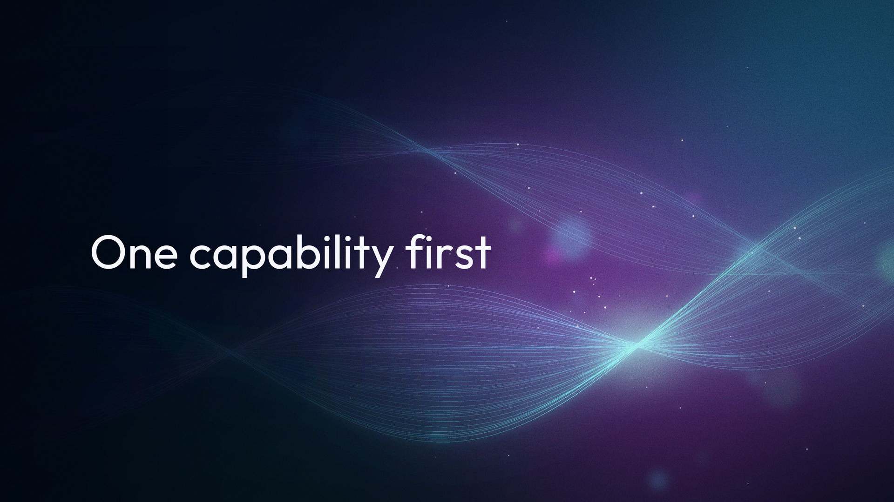
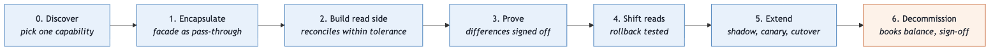

# Modernize one capability at a time. Fund the coexistence, too

Most banks that run a COBOL core on a mainframe have already had the rewrite conversation at least once. The pitch is a new platform, a migration weekend and a date for switching off the old system. Then the estimate grows, the scope grows with it, and the mainframe is still posting the ledger years later. The incremental alternative, the [Strangler Fig Application](https://martinfowler.com/bliki/StranglerFigApplication.html) Martin Fowler described, is well known by now, and routing traffic to new services piece by piece is the easier half of it.

What sits between the first route and the last teardown is harder: a period when two systems run side by side, share data and both need to be correct. Someone has to decide, fund and govern that period, and those calls usually sit with the CTO, the head of engineering or the modernization lead. This article covers them. The patterns, the Java examples and the phased plan behind it are in [legacy-modernization-patterns on GitHub](https://github.com/wallaceespindola/legacy-modernization-patterns).

## The decision is per capability, not per system

"Should we leave the mainframe?" is the wrong question for a funding meeting, because it forces one answer for everything. A core banking estate is a set of capabilities: account inquiry, ledger posting, interest, statements, customer data, notifications. Each one deserves its own decision, using the same options the industry already uses (retire, retain, rehost, replatform, repurchase, refactor).

Some capabilities should move early. Account inquiry, statements and notifications are supporting work with clear boundaries and limited financial risk. Others should move last, or not at all. Ledger posting is the core domain, the most coupled and the most expensive to get wrong. Keeping it on the mainframe, behind a clean API, is a legitimate outcome.

So the first thing I'd ask a modernization lead to produce, before any target architecture, is a capability list with a decision next to each item:

- **Move now:** low risk, clear boundary, visible benefit to customers or channels.
- **Move later:** worth moving, but only after the pipeline has been proven on easier capabilities.
- **Retain and encapsulate:** stable, cheap to run, not blocking change. Put an API in front of it and stop there.
- **Retire:** nobody uses it. Static analysis plus runtime statistics often show more unused code than people expect.

That list also protects you from the most expensive anti-pattern in this space, which is migrating the ledger first because it feels like the "real" modernization.

## Budget for coexistence and teardown

Here's the line item most plans leave out. During the transition you run the mainframe and the new services at the same time, plus the scaffolding that connects them: a routing facade, a translation layer, data-capture pipelines that copy changes from the mainframe into the new read model, reconciliation jobs that compare balances between the two. Thoughtworks' [Patterns of Legacy Displacement](https://martinfowler.com/articles/patterns-legacy-displacement/) (Ian Cartwright, Rob Horn and James Lewis) calls this transitional architecture, and it has to be built, run and paid for like any other software.

Coexistence is usually the most expensive period of the whole program, since you pay for both stacks and for the bridge between them. If the budget assumes costs fall as soon as the first route moves, the money tends to run out in the middle, and the bank ends up with two systems and no plan to remove either.

Two funding decisions follow from that:

- **Fund the coexistence period explicitly.** Mainframe capacity and the new platform's run cost, side by side, per phase. Nobody gets surprised in quarter three.
- **Fund the teardown as a deliverable.** Every piece of scaffolding needs a removal date and an owner. A translation layer with no legacy system behind it is dead weight, and a strangler with no decommission criteria becomes a permanent second system.

I'd track one number for this at portfolio level: how many transitional components are still alive. If it only goes up, the program isn't finishing anything.

## Set the cutover gates before the work starts

In banking, "the tests pass" isn't a cutover criterion. The books have to balance. The gates I'd want written down, and agreed with risk and the business, before the first line of code:

- **Reconciliation:** an automated, scheduled comparison of balances and positions between the old and new stores, with a process for every break. It has to run clean over a defined number of business days, including a month-end.
- **Proven equivalence:** a parallel run where the new service computes the same answers as the mainframe on real inputs, without side effects, and every known difference is explained and signed off.
- **Tested rollback:** going back must be a routing change, not a redeployment, and someone has to have actually done it.
- **Audit evidence:** the reconciliation results, the parallel-run reports, the decision records and the sign-offs filed where an auditor can find them years later.
- **Explicit sign-off:** business and risk approve the cutover by name, alongside engineering.

Gates written before the work starts are cheap. Gates negotiated the week before cutover are where programs either slip or take risks they shouldn't.

## The phases, one capability at a time

The plan in the repo goes through seven phases per capability, each with an exit criterion. The flow is the same every time, which is what makes it governable.

In short: discover the boundaries and pick the capability; put a facade in front of the mainframe that passes everything through unchanged; build a modern read side and reconcile it; prove equivalence in a parallel run; shift reads gradually, with the mainframe kept as a fallback; extend into newly owned events and calculations; and decommission the old path once the books balance and sign-off is filed. Ownership of writes moves in stages too, with exactly one system owning writes at any moment. Dual writes from application code are the fastest way I know to lose a reconciliation.

## Regulation is part of the plan

For EU banks, the [Digital Operational Resilience Act (DORA)](https://www.eiopa.europa.eu/digital-operational-resilience-act-dora_en), Regulation (EU) 2022/2554, has applied since 17 January 2025. It covers ICT risk management, incident reporting, resilience testing and third-party risk, including exit strategies for critical ICT providers. A modernization program that adds cloud providers and new integration paths changes that picture, so involve your resilience and risk functions from the first phase, not at cutover. The same goes for audit trail continuity across both stacks and data lineage for risk reporting. Regulators and auditors ask why a decision was taken, sometimes years later, so record architecture decisions as you go.

## What to measure

Per capability, I'd review these at every steering meeting:

- **Share of traffic routed to new services:** the basic progress signal.
- **Mainframe capacity consumed:** in banking, often the billing metric, and the business case depends on it going down.
- **Data-capture lag against its target:** the read side is only useful if it's fresh enough.
- **Reconciliation break rate and time to resolve:** the measure that decides cutover in banking.
- **Parallel-run mismatch rate:** whether the new behavior matches the old.
- **Transitional components still alive:** the teardown signal.

I don't have adoption or outcome numbers from a live rollout, and I won't invent any. These are the signals I'd use to decide whether to continue, slow down or stop.

## Pilot with account inquiry

You don't need a program-wide commitment to test this. Pick one low-risk capability and run it through every gate. Account inquiry is a good first candidate: it's read-only, high volume and customer-visible, and the ledger stays authoritative on the mainframe the whole time.

1. **Agree the gates first.** Reconciliation window, mismatch threshold, rollback test and who signs off.
2. **Install the facade as a pass-through.** All channel traffic flows through it with no behavior change. That alone proves you have an interception point.
3. **Build and reconcile the read side.** Model pending and posted transactions explicitly, or displayed balances will jump.
4. **Shadow, then canary.** Compare responses in a parallel run, then route one channel or segment, keeping the mainframe as fallback.
5. **Tear down what the pilot no longer needs.** Then review the six numbers and decide on the next capability.

Where it doesn't pay off: a system small enough to replace in one well-tested release, a capability you're replacing with a vendor package, or a mainframe workload with no interception point at all. Coexistence has a cost, and sometimes that cost is higher than a careful cutover.

## Summary

Modernizing a core banking platform is a series of capability decisions, each with its own funding, gates and teardown. Decide what moves and what stays. Budget for the period when both systems run, and for removing the scaffolding afterwards. Write the cutover gates (reconciliation, audit evidence, sign-off) before the work starts, and prove the whole loop on one low-risk capability like account inquiry before committing to the rest. I wrote about the discovery side, using AI to understand legacy systems before changing them, in [Above the rewrite](https://medium.com/@wallaceespindola/above-the-rewrite-how-ai-is-changing-legacy-modernization-ed757a9087a3).

If you lead a modernization program, which line item was hardest to get funded: the coexistence period, the teardown or the reconciliation work? Let me know your thoughts in the comments.

---

Examples repository: <https://github.com/wallaceespindola/legacy-modernization-patterns>

Need more tech insights?
Check out my GitHub, LinkedIn, and Speaker Deck.
Happy coding!

Wallace Espindola, Solution Architect

GitHub: <https://github.com/wallaceespindola/>
LinkedIn: <https://www.linkedin.com/in/wallaceespindola/>
Speaker Deck: <https://speakerdeck.com/wallacese>

**#legacymodernization #corebanking #mainframe #engineeringleadership #softwarearchitecture #stranglerfig**
