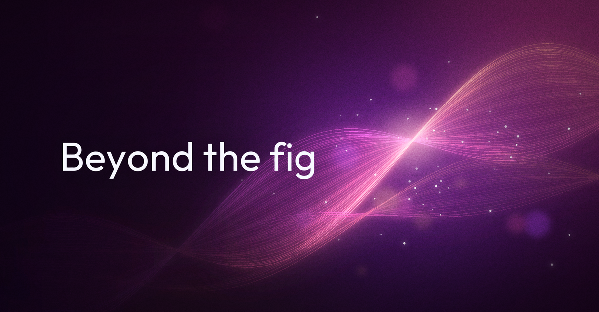
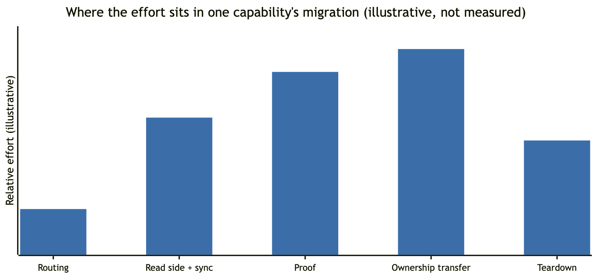

<!--
Medium metadata
Tags: Software Architecture, Legacy Modernization, Strangler Fig, Banking, Mainframe
Meta description: Routing traffic to a new service is the easy part of a Strangler Fig migration. Data ownership, proof and teardown are where the work and the risk sit.
-->

# The Strangler Fig gets the credit. Coexistence does the work

*Routing is the easy part of a legacy migration. Data ownership, proof and a removal date for the scaffolding decide whether it ever ends*

*By [Wallace Espindola](https://www.linkedin.com/in/wallaceespindola/), Solution Architect | [wallace.espindola@gmail.com](mailto:wallace.espindola@gmail.com) | [GitHub](https://github.com/wallaceespindola/)*

*I wrote this article with AI assistance, then reviewed, fact-checked and edited it myself.*

---

Most legacy modernization plans, drawn on a whiteboard, share one picture. There is a box for the old system, a box for the new one, and a facade in front of both with arrows that slowly move from left to right. Someone says "Strangler Fig", everyone nods, and the meeting moves on. It's a good picture. It's also the part of the job that takes the least time.

The hard part sits in the space between those boxes, in the months (often years) when both systems are alive, both hold data that matters, and the business expects the books to balance every single night. That period has a name in the literature, coexistence or transitional architecture, but it rarely gets the attention the pattern itself gets. In a core banking setting it is where most of the effort, the cost and the risk sit.

This is an opinion piece. I'll say what I think about where the work really is, what "done" should mean, where AI fits and where I would not use the Strangler Fig at all. The patterns and the small Java module behind this series live in [legacy-modernization-patterns](https://github.com/wallaceespindola/legacy-modernization-patterns), if you want the concrete version. I wrote earlier on Medium about [how AI is changing the way we understand legacy systems](https://medium.com/@wallaceespindola/above-the-rewrite-how-ai-is-changing-legacy-modernization-ed757a9087a3). This one is about what happens after you understand them and start moving things.

## The pattern everyone agrees on

The Strangler Fig is not controversial, and I think that's part of the problem. Martin Fowler named it after the strangler figs he saw in the Queensland rain forest, vines that grow around a host tree until the tree is no longer needed. His [Strangler Fig Application](https://martinfowler.com/bliki/StranglerFigApplication.html) page (current version dated 22 August 2024) describes replacing a legacy system gradually instead of in one big rewrite. Put an interception point in front of the old system, move one capability at a time behind it, and let the old system shrink until you can switch it off.

It's hard to argue against that. Big-bang rewrites of core systems have a bad reputation for good reasons: long periods with no value delivered, one high-stakes cutover weekend, and a new system that has to match decades of undocumented behavior on day one. Gradual replacement spreads the risk out and delivers value earlier.

What I notice is that the pattern gets the credit for the safety, as if the safety came from the routing. It doesn't. The routing is what makes gradual replacement possible. The safety comes from everything you build around it: how data moves, how you prove the new path behaves like the old one, how you decide who owns which record, and how you get rid of the scaffolding at the end. Fowler says as much on the same page. People "often balk at the necessity of building transitional architecture", which he describes as code "that will go away once the modernization is complete", and he argues the reduced risk is worth that cost. I agree with him. I just think most plans underestimate how big that transitional part is.

## Routing is the easy part

I don't want to undersell the facade. Picking the interception point is a real design decision. On a mainframe you might expose functions as REST through something like IBM z/OS Connect, intercept messages on IBM MQ queues, capture state changes with change data capture (CDC), or replace batch jobs file by file. Each has trade-offs, and some legacy systems give you no clean boundary at all.

Once you have the boundary, though, routing itself is well understood. You install the facade as a pass-through first, with 100% of traffic still going to legacy and no behavior change. Then you flip routes per operation (`GET /accounts/{id}/balance`, not "the accounts screen"), per channel or per customer segment. Feature toggles make every flip reversible. If something looks wrong, you route back.

That last sentence is where the easy part ends. "Route back" works as long as the legacy system still owns the data. As soon as the new service starts accepting writes that legacy doesn't know about, rolling back is no longer a configuration change. It's a data problem.

So here is the first thing I'd say to anyone starting one of these programs: the facade is the cheap part, and it should be. If your plan spends most of its effort designing the gateway, the effort is probably in the wrong place.

## Data ownership is the hard part

Moving code is easy compared to moving the authoritative copy of the data. I'd go further: almost every complementary pattern people bolt onto a Strangler Fig exists either to move ownership safely or to live with split ownership for a while.

Think about a bank account. In a typical COBOL core, the ledger is the system of record. It posts transactions, runs end-of-day batch, accrues interest and feeds statements, regulatory reports and settlement. You want a modern account inquiry service for the mobile app. The inquiry service needs balances. Where do they come from?

The safe answer is that legacy keeps owning the writes and the new service gets a read copy through CDC. That sounds simple until you hit the details. CDC records are shaped like the legacy schema, so they need a translation step (an anti-corruption layer for data) or the new model quietly inherits the old structure. Many cores memo-post during the day and hard-post in the nightly batch, and CDC sees both, so the read model has to separate pending from posted or displayed balances will jump. You need a lag objective, per-account ordering, deduplication, a replay procedure and a runbook for the day someone changes a copybook. None of that is routing, and all of it is coexistence work.

Then comes the step that actually ends the migration: the new service takes over the writes. The rule I hold to here is simple and strict. Exactly one system owns writes for a given piece of data at any moment. No dual writes from application code into both stores, because a partial failure will make them diverge and you'll find out at month-end. Ownership moves in stages:

- **Stage 1:** legacy owns writes, and the new side is a read copy fed by CDC.
- **Stage 2:** legacy still owns writes, and the new side computes in shadow, reconciled daily.
- **Stage 3:** the new side owns writes, and legacy becomes a read copy through reverse synchronization.
- **Stage 4:** the remaining legacy consumers (batch, reports, regulatory feeds) are migrated, and reverse sync is retired.

Stage 3 is the one people forget to plan for. After the new service owns the account, the old batch jobs, reports and downstream feeds still expect the data where it used to be. Somebody has to keep feeding them until they move too. That reverse path is more transitional architecture, with its own lag, its own failures and its own reconciliation.

This is why I think the "which system owns this record today" question deserves its own artifact: a table per capability, reviewed like any other architecture decision. If two people on the program give different answers to it, the plan has a gap.

## Coexistence is a cost with a removal date

Every piece of transitional architecture has to be designed, built, run, monitored, on-call supported and, eventually, removed. Facades, CDC pipelines, translation layers, reconciliation jobs, reverse sync, shadow comparison, routing toggles. Each one is real software with real operating cost. During coexistence you're also paying for both stacks at once, including mainframe capacity that doesn't shrink until you actually switch something off. My view is that coexistence is usually the most expensive period of the whole program, and it should be budgeted that way.

*Illustrative, not measured. It shows where I'd expect the effort to sit for one capability. Routing is the smallest bar, and ownership transfer, proof and teardown are much larger.*

The trap is what the [Patterns of Legacy Displacement](https://martinfowler.com/articles/patterns-legacy-displacement/) catalog (Ian Cartwright, Rob Horn and James Lewis, first published July 2021) defines in one line: transitional architecture is "software elements installed to ease the displacement of a legacy system that we intend to remove when the displacement is complete." The word that matters is "intend". Intentions don't remove anything. If nobody owns the teardown, and nobody put a date and a budget on it, the scaffolding stays. The new service works, the old one still runs because "some report needs it", the CDC pipeline keeps flowing, and the reconciliation job keeps finding small breaks that someone triages every morning.

That is how a strangler turns into a perpetual second system, without anyone deciding it, because removal was never anyone's deliverable. You end up running and paying for both stacks indefinitely, with more moving parts than before you started.

So I treat every transitional component the way I'd treat a loan. It gets an owner, a reason, an exit condition and a target date when it's created, not when someone finally notices it. The number of transitional components still alive per capability is one of the metrics I'd put on the program dashboard, next to traffic share and reconciliation breaks. If that number only goes up, the migration isn't converging.

I also think funding matters here more than people admit. Programs tend to be funded for building the new thing. Teardown work doesn't demo well, and it competes with the next capability on the roadmap. If the business case doesn't show value per phase, including what you save when legacy pieces actually go away, money tends to dry up in the middle, and the middle is exactly where both systems are running.

## What "done" means

I've come to think the most useful thing a modernization program can do early is write down what "done" means for a single capability, before anyone argues about the whole system. I think the honest definition has three parts:

1. The new system owns its data. It is the single writer for that capability, and nothing depends on a legacy copy as the source of truth.
2. The books balance. Reconciliation between the old and new stores has run clean over a period that includes the awkward dates (month-end, year-end, holidays, leap days), and every known difference is explained and signed off.
3. The legacy path is off. The transitional pieces for that capability are removed and the audit evidence is filed. A fallback still running "just in case" doesn't count.

A common definition stops at "100% of traffic is routed to the new service". That's a milestone, and a good one, but it isn't done. If legacy still owns the writes, you've moved reads. If legacy still runs and nobody can turn it off, you've added a system.

In banking, there's another reason to be strict: a cutover needs reconciliation and audit evidence, and green tests alone won't get it approved. Tests tell you the code does what you think. Reconciliation tells you the money is where it should be. Those are different questions, and only the second one matters to the people who sign off.

This is also why I think parallel run deserves more respect than it gets. Running old and new side by side on the same inputs and comparing outputs sounds like a script. In practice it's a product: tolerance rules for rounding, field mappings, a list of known differences, a sampling rate and a triage workflow. Many mismatches turn out to be false alarms from rounding modes, day-count conventions, business date versus system date or time zones, and someone has to sort those from the real ones. The shadow path also must never create real side effects, so no duplicate payments and no customer notifications. That needs to be enforced by configuration, not by everyone remembering.

## Where AI helps, and where it must not decide

I'm not neutral on AI in this space. I think it's useful, and I think the most useful part is understanding, not writing new code.

Legacy estates are big, old and under-documented. AI is good at reading a COBOL program and explaining it, at proposing candidate business rules from code, at drafting mappings from copybooks to modern schemas, at suggesting characterization test cases, and at clustering parallel-run mismatches by likely cause (rounding, date logic, data quality) so experts review categories instead of rows. All of that shortens the part of the program where people stare at code trying to work out what it does.

Where I draw a hard line is financial behavior. AI should not decide how interest is calculated, how a fee rounds or whether a reconciliation break is acceptable. It can propose, and humans plus deterministic checks decide. I think of AI as a candidate generator and of tests, reconciliation and expert review as the gate.

The risks are specific enough to name. A model can extract a business rule that is plausible and wrong, so every extracted rule needs a trace back to the source program and paragraph that a reviewer can check. Generated tests can encode the model's own misunderstanding, so they have to be validated against real legacy outputs, not against generated code. Line-by-line translation from COBOL produces Java that keeps the old structure and is hard to maintain, so I'd use AI to understand rules and re-express them in the new domain model, not to transliterate. And core banking source is sensitive, so it only goes to approved deployment models, never with production data pasted into prompts. Keep the prompts, versions and human sign-offs as audit evidence, like any other tool in the change process.

None of this changes the earlier argument. AI can make the understanding phase shorter. It doesn't make data ownership easier, and it doesn't remove the need to prove equivalence with real numbers.

## Where I'd be careful, and where this doesn't apply

I've spent most of this piece saying the Strangler Fig needs more around it. It also isn't always the right choice. Here's where I'd hesitate or not use it at all:

- **No interception point:** if the legacy system has no API, queue or data boundary you can put a facade on, you can't strangle it in the usual way. Sometimes event interception through CDC or MQ gives you a boundary. Sometimes it doesn't, and pretending otherwise just delays the real decision.
- **Small enough to replace at once:** if the system can be replaced in one well-tested release, coexistence may cost more than the cutover. Gradual isn't automatically safer when the transitional architecture is bigger than the thing you're replacing.
- **Replacing with a vendor package:** when you're moving to a purchased product, migration is mostly about data and process. Parallel run and reconciliation still apply, but routing capability by capability often doesn't map onto how a package is adopted.
- **Stable, cheap and not blocking anyone:** some mainframe workloads are reliable, inexpensive to run and not in the way of change. Retaining them and wrapping them behind clean APIs is a legitimate outcome. Modernization is a decision per capability, not a vote on the whole platform.
- **Ledger first:** even when the pattern fits, I'd be careful about the order. Moving the most coupled, highest-risk core domain before the team has proven the pipeline on low-risk capabilities (inquiry, notifications, statements) is asking for trouble.

There are also a few anti-patterns that look like progress and aren't. One microservice per COBOL program rebuilds the 1980s structure with network latency added. New services reading legacy tables directly skip the translation layer and inherit the old schema. And the "incremental" migration where code moves gradually but all the data moves in one weekend is a big bang with extra steps.

I'll also be clear about the limits of what I'm saying. I don't have adoption numbers or cost data from a live program to share, and I won't invent any. The effort chart above is an illustration of where I'd expect the work to land, not a measurement. Regulatory context matters too and varies by jurisdiction. In the EU, for example, the [Digital Operational Resilience Act (Regulation (EU) 2022/2554)](https://eur-lex.europa.eu/eli/reg/2022/2554/oj) has applied since 17 January 2025 and shapes how banks think about operational resilience and exit strategies during a change like this. Your constraints may differ.

## Wrapping up

I like the Strangler Fig. I'd still pick it for most core banking modernizations where an interception point exists. I just think we give it credit for work it doesn't do. Here's where I've landed:

- Routing is the easy part, and it should stay cheap. A plan that spends most of its effort on the gateway is looking in the wrong place.
- Data ownership is the hard part. One writer at a time, staged transfer, no dual writes, and an explicit answer to "who owns this record today" per capability.
- Coexistence is a cost with a removal date. Every transitional component gets an owner, an exit condition and a budget for teardown, or the strangler becomes a perpetual second system.
- "Done" means the new system owns its data, the books balance and the legacy path is off. Routing 100% of traffic is a milestone, not the finish line.
- AI helps with understanding and with sorting the noise. It doesn't decide financial behavior. Tests, reconciliation and people do.
- Sometimes the right answer is not to strangle at all, and to retain, replace in one release or buy instead.

I'm curious how this looks from where you sit. Does your modernization plan have a line item for teardown, or only for building? Who in your program owns the decision about which system holds the authoritative copy, and is it written down anywhere? And if you've seen a strangler that never finished, what kept the old system alive? Let me know in the comments.

---

Examples repository: <https://github.com/wallaceespindola/legacy-modernization-patterns>

Need more tech insights?
Check out my GitHub, LinkedIn, and Speaker Deck.
Happy coding!

Wallace Espindola, Solution Architect
GitHub: <https://github.com/wallaceespindola/>
LinkedIn: <https://www.linkedin.com/in/wallaceespindola/>
Speaker Deck: <https://speakerdeck.com/wallacese>
