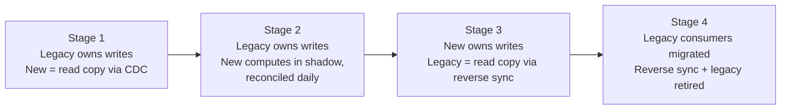
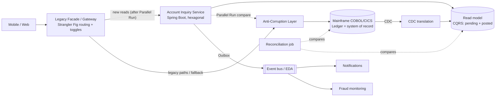

# Context: Architecture Patterns for Legacy Modernization

> Strangler Fig and complementary patterns for banking systems.
> Use this file as context for articles, decks, design docs, or AI-assisted architecture work.
> Covers the core patterns, mainframe and banking nuances, missing patterns, anti-patterns, and regulatory constraints.

## Executive Summary

- **Strangler Fig** gives a safe way to gradually replace legacy capabilities, but it does not solve every modernization problem on its own.
- Combine it with domain modeling, translation boundaries, synchronization, event reliability, testing, and operational resilience patterns.
- Modernization can **retain valuable mainframe workloads**. Full replacement is not required.

The "retain" option matches the industry _R_ frameworks (Gartner 5Rs / AWS 7Rs: retire, retain, rehost, relocate, replatform, repurchase, refactor). Modernization is a **portfolio decision per capability**, not one decision for the whole system.

Three more framing points:

1. **Data ownership is the hard part.** Moving code is easy compared to moving the _authoritative copy_ of the data. Every pattern below exists either to move ownership safely or to live with split ownership for a while.
2. **Coexistence is a cost, not a phase you can ignore.** Transitional architecture (facades, CDC pipelines, reconciliation jobs) has to be built, run, and eventually removed. Budget for teardown, or the "strangler" becomes a permanent second system.
3. **Financial correctness beats velocity.** In banking, a cutover is gated by reconciliation and audit evidence, not by "the tests pass".

## 1. Principal Patterns and Use Cases

| #   | Pattern                             | What it does                                                                                                    | Banking use case                                                              | Watch out for                                                                         |
| --- | ----------------------------------- | --------------------------------------------------------------------------------------------------------------- | ----------------------------------------------------------------------------- | ------------------------------------------------------------------------------------- |
| 1   | **Strangler Fig**                   | Gradually route specific functions from legacy to modern services; the rest stays on the mainframe              | Downtime and big-bang replacement are unacceptable                            | Correct routing, temporary coexistence, data ownership, rollback                      |
| 2   | **Anti-Corruption Layer (ACL)**     | Translate legacy protocols, record structures, errors, and domain semantics into clean modern interfaces/models | Around COBOL, IBM CICS, proprietary record formats                            | Keeps old assumptions from contaminating new services                                 |
| 3   | **Branch by Abstraction**           | Put an interface around a tightly coupled implementation, gradually switch callers to the replacement           | Replacing individual calculations or internal modules                         | Use when gateway routing can't isolate the logic                                      |
| 4   | **Domain-Driven Design (DDD)**      | Identify bounded contexts; assign responsibilities to business capabilities                                     | Accounts, Lending, Payments, Customer, Ledger                                 | Avoid one microservice per legacy program or copying arbitrary legacy boundaries      |
| 5   | **Change Data Capture (CDC)**       | Propagate committed source changes to new projections and downstream consumers                                  | New account inquiry while legacy ledger stays authoritative                   | Lag, sequencing, duplicates, schema evolution, reconciliation                         |
| 6   | **CQRS**                            | Separate transactional writes from read-optimized models                                                        | High-volume mobile banking inquiries without moving posting off the mainframe | Explain eventual consistency to consumers                                             |
| 7   | **Transactional Outbox**            | Commit state change + outgoing event record in one local DB transaction; publish asynchronously                 | Reliable payment/account event propagation                                    | Consumers still need idempotency                                                      |
| 8   | **Event-Driven Architecture (EDA)** | Publish domain events to decouple integrations                                                                  | Notifications, fraud monitoring, audit pipelines, analytics                   | Ordering, replay, schema evolution, error-handling policies                           |
| 9   | **Saga**                            | Coordinate multi-service process via local transactions + compensating actions                                  | Multi-step loan origination, onboarding                                       | **Not** a substitute for atomic ledger posting                                        |
| 10  | **Parallel Run / Shadow Traffic**   | Run old and new with equivalent inputs, compare outputs before cutover                                          | Interest calculations, fees, risk rules                                       | Shadow processing must not create duplicate financial or customer-facing side effects |
| 11  | **Hexagonal Architecture**          | Separate domain logic from interfaces/infrastructure via ports and adapters                                     | Swap mainframe adapters without rewriting the domain                          | Don't over-port: one adapter per port is fine                                         |
| 12  | **Circuit Breaker + Bulkhead**      | Limit cascading failures, isolate resources when legacy deps are slow/unavailable                               | Protecting modern services from mainframe latency/outages                     | Timeouts and retries on financial writes where the outcome may be uncertain           |

### 1.1 Pattern details

#### Strangler Fig

- **Interception points** are the real design decision. On a mainframe, the usual options are:
  - an API gateway/facade in front of channel traffic, with mainframe functions exposed as REST (e.g. IBM z/OS Connect);
  - message interception on IBM MQ queues;
  - _event interception_, where state changes come from CDC instead of calls;
  - file/batch interception for JCL batch flows.
- **Install the facade early as a pass-through** (100% to legacy). Then you can flip routes per capability, per channel, or per customer segment (canary) without changing clients.
- **Routing granularity:** per operation (e.g. `GET /accounts/{id}/balance`), not per screen or per COBOL program.
- **Rollback must be a routing change, not a deployment.** If the new service has already taken write ownership, rollback also needs data to flow back into legacy (see §1.2 Data ownership transfer).
- **Batch is often the bigger half.** Online CICS transactions get the attention, but end-of-day batch (interest accrual, statements, settlement files) holds much of the business logic. Strangle batch separately, job by job or file by file (e.g. Spring Batch replacing a JCL step whose input/output files stay identical).

#### Anti-Corruption Layer

- **What it translates:**
  - EBCDIC → UTF-8;
  - packed decimal (COMP-3) → `BigDecimal`;
  - fixed-width copybook records → typed DTOs;
  - legacy return codes / CICS abend codes → domain errors;
  - overloaded fields (one field meaning different things depending on a record type flag) → explicit types.
- **Semantic translation is the valuable part**, not syntax. Example: legacy "balance" may be ledger balance, available balance, or memo-posted balance depending on context. The ACL must make that explicit.
- **Risk:** the ACL can turn into a new monolith or a latency hotspot. Keep one ACL per bounded context. Give it versioned contracts and no business logic beyond translation.
- **Retire it** together with the legacy capability behind it. An ACL with no legacy behind it is dead weight.

#### Branch by Abstraction

- Needs **code-level access** to the caller. In COBOL estates, the "abstraction" is often a CICS `LINK` target program, a called subprogram, or a copybook interface. The new implementation can be another COBOL program or a call out to a Java service.
- **Pair it with feature toggles** so you can switch per call path and revert without redeploying.
- **Pair it with characterization tests** (Feathers' _Working Effectively with Legacy Code_) / golden-master tests. They pin current behavior, _including bugs that downstream systems depend on_, before you swap the implementation.

#### Domain-Driven Design

- Use **Event Storming** and **Context Mapping** to find boundaries. Context-map relationships (conformist, customer–supplier, ACL, published language) tell you exactly where ACLs are needed.
- **Classify subdomains:**
  - _Ledger/posting_ is the core domain. It is usually moved last or retained.
  - _Customer notifications, statements, inquiry_ are supporting/generic domains. They are good first candidates.
- **Prefer capability boundaries over code boundaries.** Legacy program structure reflects 1980s batch/online splits, not business capabilities.

#### Change Data Capture

- **Source matters:** Db2 for z/OS has mature log-based CDC tooling. IMS and VSAM are harder and tool-dependent. Confirm CDC feasibility per data store early. It can decide the whole approach.
- **CDC exposes the physical schema.** Raw CDC records are legacy-shaped, so route them through a translation step (an ACL for data) before they reach the new read model. Otherwise the new model inherits the legacy schema.
- **Banking nuance — intraday vs posted:** many cores memo-post during the day and hard-post in the end-of-day batch. CDC will see both. The read model must model _pending_ vs _posted_ explicitly, or displayed balances will jump.
- **Operational controls:**
  - a lag SLO with alerting;
  - per-key ordering (partition by account ID);
  - deduplication by source log position;
  - a replay / initial-snapshot procedure;
  - a schema-change runbook, because copybook changes break pipelines.

#### CQRS

- **Read-your-own-writes** is the UX problem. A customer pays, then sees the old balance. Mitigations:
  - overlay pending transactions in the client;
  - return a version/sequence token and have the read side wait or fall back to legacy if it is behind;
  - show "last updated" timestamps.
- **Fallback path:** if CDC lag breaches the SLO, the facade can route balance reads back to legacy via the ACL. That turns CQRS into a reversible step.
- **CQRS ≠ Event Sourcing.** You don't need event sourcing to apply CQRS here. The mainframe ledger is already the write model.

#### Transactional Outbox

- **On the mainframe side,** the equivalent is writing the event to a Db2 outbox table, or putting it on MQ, inside the **same CICS unit of work / syncpoint** as the business update. This is a well-established mainframe technique.
- **Relay options:** polling publisher, or CDC on the outbox table (log tailing, e.g. Debezium on the modern side). Log tailing avoids polling load and keeps commit order.
- **Delivery is at-least-once,** so consumers need an **Idempotent Consumer / Inbox** (dedupe table keyed by event ID, updated in the same transaction as the consumer's state change).

#### Event-Driven Architecture

- **Be explicit about the event style:** _event notification_ (thin, consumer calls back), _event-carried state transfer_ (fat, consumer keeps a local copy), or _event sourcing_ (events are the record). They have very different coupling and data-protection profiles.
- **Ordering:** guaranteed only per partition, so partition by aggregate (account ID).
- **Governance:**
  - schema registry with compatibility rules (Avro/Protobuf/JSON Schema);
  - dead-letter queue (DLQ) with a reprocessing runbook;
  - retention long enough for replay.
- **Personal data in events:** GDPR erasure is hard on immutable logs. Keep personal data out of events where you can, or use crypto-shredding (encrypt per customer, delete the key).

#### Saga

- **Compensation in banking is a reversal entry, not a rollback.** Accounting never deletes, it books an offsetting entry, so compensation is natural for financial steps _if_ the ledger supports reversals.
- **Orchestration vs choreography:** prefer **orchestration** for regulated multi-step flows (loan origination, onboarding/KYC). It gives one place to see state, audit, and time out.
- **Design the pivot transaction:** the step after which the saga can only go forward (e.g. disbursement). Put irreversible and customer-visible actions after it.
- **Isolation anomalies:** sagas have no isolation, so use semantic locks (e.g. `PENDING_APPROVAL` state) to stop concurrent sagas from acting on half-finished data.

#### Parallel Run / Shadow Traffic

- **Comparison is a product, not a script.** Define:
  - tolerance rules (rounding);
  - field mapping;
  - known-difference allowlist;
  - sampling rate;
  - a discrepancy triage workflow.
- **Common false mismatches:**
  - rounding mode (COBOL `ROUNDED` is half-up by default; Java `BigDecimal` needs an explicit `RoundingMode`);
  - day-count conventions (30/360 vs ACT/365);
  - business date vs system date;
  - time zones;
  - order of operations in intermediate truncation.
- **Side-effect isolation:** the shadow path writes to sandboxed stores and has notification/payment adapters stubbed. Make that enforced by configuration, not by convention.
- **Stages:** shadow (new result discarded, compared) → canary (new result served to a small segment, legacy still computed and compared) → full cutover → legacy kept warm for a defined rollback window.

#### Hexagonal Architecture

- Main payoff during migration: **the same domain core runs against a mainframe adapter (via ACL) today and a native repository tomorrow.** Contract tests on the port prove both adapters behave the same.
- Lets domain logic be unit-tested without mainframe access. Test environments are often the scarcest mainframe resource.

#### Circuit Breaker + Bulkhead

- **A timeout is not a failure; it is an unknown outcome.** For posting/payment calls:
  - require an **idempotency key** end to end;
  - on timeout, **query status** before any retry;
  - never blind-retry a non-idempotent write;
  - send anything still unresolved to a reconciliation queue.
- **Protect the mainframe, too:** retries and fan-out raise MIPS/MSU consumption, which is often the billing metric. Add rate limiting / load shedding at the facade, and retry budgets.
- **Bulkhead per legacy dependency** (separate connection pools for CICS, MQ, Db2), so a slow batch window on one doesn't starve inquiries on another.

### 1.2 Supporting patterns

| Pattern                                       | Why it matters here                                                                                                                                                       |
| --------------------------------------------- | ------------------------------------------------------------------------------------------------------------------------------------------------------------------------- |
| **API Gateway / Legacy Facade**               | The concrete interception point that Strangler Fig needs. It also centralizes auth, rate limiting, and routing toggles.                                                   |
| **Event Interception** (Fowler)               | Strangle by intercepting state changes (CDC/MQ) rather than calls. Useful when there is no clean call boundary.                                                           |
| **Idempotent Consumer / Inbox**               | The required partner of Outbox, EDA, and any retried call.                                                                                                                |
| **Characterization / Golden-Master Testing**  | Pins legacy behavior before Branch by Abstraction or a rewrite. Gives Parallel Run its baseline.                                                                          |
| **Feature Toggles / Canary Release**          | Make every routing and implementation switch reversible and gradual.                                                                                                      |
| **Reconciliation (as a first-class pattern)** | Scheduled, automated comparison of balances/positions between legacy and new stores, with break management. The real cutover gate in banking.                             |
| **Data Ownership Transfer (staged)**          | Moves the authoritative copy safely without dual writes (see below).                                                                                                      |
| **Reverse Synchronization**                   | After the new service owns writes, legacy batch, reports, and regulatory feeds still need the data. Use reverse CDC or ACL write-back until those consumers are migrated. |
| **Distributed Tracing / Correlation IDs**     | Propagate one correlation ID from channel → facade → service → CICS transaction/MQ message. Without it, incident triage across two worlds is guesswork.                   |

**Data ownership transfer — staged, single writer at every stage:**

Rule: **never dual-write** from application code to both stores. Exactly one system owns writes at any moment; the other gets data through CDC or a sync path.

### 1.3 Anti-patterns to call out

- **Distributed monolith:** services that must deploy together or call each other synchronously in chains. Usually caused by splitting along legacy program boundaries.
- **One microservice per COBOL program:** reproduces 1980s structure with network latency added.
- **Dual writes** from application code to legacy and new stores: guarantees divergence on partial failure.
- **Shared database integration:** new services reading legacy tables directly, bypassing the ACL.
- **Ledger first:** migrating the highest-risk, most-coupled core domain before the team has proven the pipeline on low-risk capabilities.
- **Perpetual strangler:** no decommission criteria, so the bank runs and pays for both stacks indefinitely.
- **Big-bang data migration disguised as incremental:** code goes incrementally, but all data moves in one weekend.
- **Leaky ACL:** legacy field names, codes, or record shapes showing up in new APIs and events.

## 2. How the Patterns Work Together: Account Modernization Example

**Starting point:** COBOL core banking on a mainframe stays system of record for ledger posting and settlement. Goal: modern Java / Spring Boot account inquiries and a better mobile UX.

1. **DDD** — delineate Account Inquiry, Ledger Posting, Interest, and Customer responsibilities.
2. **ACL** — present stable modern interfaces over legacy account data and functions.
3. **Strangler Fig** — install the facade at a controlled interface boundary as a pass-through (100% legacy); flip routes only after the Parallel Run proves equivalence.
4. **CDC** — populate a modern, read-optimized account view.
5. **CQRS** — scale reads independently; financial writes stay authoritative in the ledger.
6. **Parallel Run** — compare balance display and calculation behavior against legacy.
7. **EDA + Transactional Outbox** — for suitable newly owned business events.
8. **Branch by Abstraction** — where feasible, replace internal legacy calculations.
9. **Decommission** selected capabilities only after financial reconciliation, operational validation, and explicit cutover approval.

**Phases and exit criteria:**

| Phase              | Steps                                                                                                                                                                          | Exit criterion                                                                               |
| ------------------ | ------------------------------------------------------------------------------------------------------------------------------------------------------------------------------ | -------------------------------------------------------------------------------------------- |
| 0. Discover        | DDD (Event Storming, context map), dependency analysis, CDC feasibility per data store, baseline metrics (MIPS, latency, error rates)                                          | Bounded contexts agreed; first capability selected (Account Inquiry)                         |
| 1. Encapsulate     | ACL over legacy account functions; facade installed as **pass-through** (100% legacy); correlation IDs end to end                                                              | All channel traffic flows through the facade with no behavior change                         |
| 2. Build read side | CDC → translation → read model (CQRS); pending vs posted modeled; lag SLO and fallback-to-legacy route                                                                         | Read model reconciles with legacy within tolerance over N business days, including month-end |
| 3. Prove           | Parallel Run / shadow on balance and inquiry responses; discrepancy triage                                                                                                     | Mismatch rate below agreed threshold; all known differences explained and signed off         |
| 4. Shift reads     | Canary route flips per channel/segment → 100%; legacy path kept as fallback                                                                                                    | SLOs hold at full traffic; rollback tested                                                   |
| 5. Extend          | Outbox + EDA for newly owned events (notifications, fraud signals); Branch by Abstraction for selected calculations (e.g. interest) with characterization tests + Parallel Run | Each replacement passes its own shadow → canary → cutover                                    |
| 6. Decommission    | Remove legacy path, ACL pieces, and transitional pipelines for the capability                                                                                                  | Financial reconciliation clean, audit evidence filed, explicit business + risk sign-off      |

## 3. Where a Solution Architect Adds Value

- Pick the right pattern for the specific problem; avoid pattern-driven overengineering.
- Identify business capability boundaries, authoritative data ownership, and transaction semantics.
- Define gateway routing, interface contracts, event schemas, resilience, and observability.
- Decide which workloads stay on the mainframe and which move.
- Define phased rollout, testing, reconciliation, recovery, rollback, and acceptance criteria.
- **Making trade-offs explicit and recorded:** ADRs (Architecture Decision Records) for every pattern choice. Regulators and auditors ask _why_, years later.
- **Owning the business case:** the modernization roadmap has to show value per phase (MIPS reduction, time-to-market, risk reduction), or funding stops mid-strangle.
- **Transitional architecture lifecycle:** design the scaffolding _and_ its removal date.
- **Regulatory alignment:**
  - operational resilience and ICT third-party risk (in the EU: DORA, applicable since January 2025; includes exit strategies for cloud providers);
  - data lineage for risk reporting (BCBS 239);
  - audit trail continuity across both stacks;
  - PCI DSS scope for card data.
- **Capacity and cost model:** mainframe MSU/MIPS vs cloud run cost during coexistence. Coexistence is usually the _most_ expensive period.
- **Team topology:** align teams to bounded contexts (Conway's Law). Pair mainframe and modern engineers so legacy knowledge transfers before people retire.
- **Non-functional parity:** batch windows, cut-off times, end-of-day/month-end/year-end processing, and leap-year/holiday calendars. These are where "equivalent" systems diverge.

## 4. Where Artificial Intelligence (AI) Adds Value

- Discover legacy dependencies and suggest extractable domains.
- Extract and document candidate business rules.
- Propose semantic mappings for the ACL.
- Generate interface specifications, adapter implementations, and test candidates.
- Analyze CDC schema mappings and reconciliation anomalies.
- Identify possible domain events and contracts.
- Explain discrepancies in parallel-run outputs.

**Guardrail:** validate all AI output with static analysis, expert review, deterministic tests, secure source handling, and reconciliation.

Treat AI as a _candidate generator_ and humans plus deterministic checks as the _gate_. The vendor ecosystem has moved this way, with mainframe-specific assistants from the major platform and cloud vendors (e.g. IBM watsonx Code Assistant for Z, AWS Transform for mainframe). Treat specific tool capabilities as moving targets and evaluate them against your own code.

**More high-value uses:**

- **Copybook → schema generation:** COBOL copybooks to JSON Schema / Avro / Java records, including REDEFINES and OCCURS DEPENDING ON handling. Verify with round-trip tests on real records.
- **Characterization test generation:** use production-like inputs to generate golden-master cases. Humans decide which current behaviors are bugs vs requirements.
- **Dead code and unused path detection:** combine static analysis with runtime usage (SMF/CICS statistics) to shrink scope before migrating. Often a big share of the estate is unused.
- **Documentation recovery:** explain programs, JCL flows, and data lineage for onboarding modern engineers.
- **Parallel-run triage:** cluster mismatches by root cause (rounding, date logic, data quality) so experts review categories, not rows.

**Specific risks to manage:**

- **Plausible but wrong business rules.** Require **traceability**: every extracted rule cites source program, paragraph, and line, so a reviewer can verify it.
- **Tests that encode the AI's misunderstanding.** Generated tests must be validated against real legacy outputs, not against generated code.
- **Source confidentiality.** Core banking source is sensitive IP and may embed security logic. Use approved deployment models (private/on-prem or contractually bound endpoints), apply data-classification rules, and never paste production data into prompts.
- **Translation literalism.** Line-by-line COBOL→Java output ("JOBOL") keeps legacy structure and is hard to maintain. Use AI to understand and re-express rules inside the new domain model, not to transliterate.
- **Model governance:** keep prompt/version records and human sign-off records as audit evidence, as with any other tool in the change process.

## 5. Pattern Selection Shortcuts

| Goal                            | Patterns                                         |
| ------------------------------- | ------------------------------------------------ |
| Replace gradually               | Strangler Fig + ACL                              |
| Define service boundaries       | DDD + Hexagonal Architecture                     |
| Modernize reads first           | CDC + CQRS                                       |
| Publish reliable events         | Transactional Outbox + EDA                       |
| Replace an internal module      | Branch by Abstraction + characterization testing |
| Coordinate non-atomic workflows | Saga (only when compensation is meaningful)      |
| Prove equivalence               | Parallel Run + financial reconciliation          |
| Contain failures                | Circuit Breaker + Bulkhead                       |

**Additional shortcuts:**

| Goal                                        | Patterns                                                                                            |
| ------------------------------------------- | --------------------------------------------------------------------------------------------------- |
| Consume events safely                       | Idempotent Consumer / Inbox + DLQ                                                                   |
| No clean call boundary to intercept         | Event Interception (CDC/MQ) + ACL                                                                   |
| Move write ownership                        | Staged Data Ownership Transfer + Reverse Sync + Reconciliation                                      |
| Make every switch reversible                | Feature Toggles + Canary + facade-level fallback                                                    |
| Safe financial writes over unreliable links | Idempotency keys + status inquiry + reconciliation queue (not blind retries)                        |
| Modernize batch                             | File/job-level strangling + golden-master comparison of output files                                |
| Debug across both worlds                    | Correlation IDs + distributed tracing (e.g. OpenTelemetry) through facade, services, and MQ headers |

### When **not** to use Strangler Fig

- The legacy system has **no interception point**: no API, queue, or data boundary you can put a facade on.
- The system is **small enough** to replace in one well-tested release, and coexistence would cost more than the cutover.
- You are **replacing it with a vendor package** (repurchase). Migration there is data- and process-driven, though Parallel Run and reconciliation still apply.
- The capability is **stable, cheap to run, and not blocking change**. Retain it and encapsulate it behind APIs.

### Measuring progress

Track per capability:

- share of traffic routed to new services;
- legacy MIPS/MSU consumed;
- CDC lag against its SLO;
- reconciliation break rate and time to resolve;
- parallel-run mismatch rate;
- number of transitional components still alive.

The last metric keeps the "perpetual strangler" visible.

## Key Message

Strangler Fig is the **migration framework**; DDD identifies **what to extract**; ACL **protects the new design**; data and messaging patterns **enable coexistence**; parallel validation plus resilience controls **make the journey safe**; and **reconciliation plus staged data-ownership transfer decide when it is actually done**. A capability is modernized only when the new system owns its data, the books balance, and the legacy path has been switched off.

## Glossary

- **ACL** — Anti-Corruption Layer
- **ADR** — Architecture Decision Record
- **BCBS 239** — Basel Committee principles for risk data aggregation and reporting
- **CDC** — Change Data Capture
- **CICS** — IBM Customer Information Control System
- **COBOL** — Common Business-Oriented Language
- **COMP-3** — COBOL packed-decimal numeric storage format
- **CQRS** — Command Query Responsibility Segregation
- **DDD** — Domain-Driven Design
- **DLQ** — Dead-Letter Queue
- **DORA** — EU Digital Operational Resilience Act
- **EBCDIC** — Extended Binary Coded Decimal Interchange Code (mainframe character encoding)
- **EDA** — Event-Driven Architecture
- **JCL** — Job Control Language (mainframe batch)
- **MIPS / MSU** — mainframe capacity and billing units
- **VSAM / IMS** — mainframe file system / hierarchical database

## References

- Martin Fowler — _Strangler Fig Application_; _Patterns of Legacy Displacement_ (with Ian Cartwright, Rob Horn, James Lewis); _Branch by Abstraction_; _Event Interception_
- Eric Evans — _Domain-Driven Design_ (2003): Bounded Context, Context Map, Anti-Corruption Layer
- Sam Newman — _Monolith to Microservices_ (2019)
- Michael Feathers — _Working Effectively with Legacy Code_ (2004): characterization tests
- Chris Richardson — _Microservices Patterns_ (2018): Saga, Transactional Outbox, Idempotent Consumer
- Alistair Cockburn — _Hexagonal Architecture_ (Ports and Adapters)
- Michael Nygard — _Release It!_: Circuit Breaker, Bulkhead
- Hector Garcia-Molina & Kenneth Salem — _Sagas_ (1987)

---

**Author:** Wallace Espindola, Solution Architect — [wallace.espindola@gmail.com](mailto:wallace.espindola@gmail.com) · [LinkedIn](https://www.linkedin.com/in/wallaceespindola/) · [GitHub](https://github.com/wallaceespindola/)
