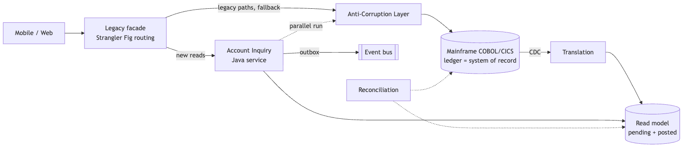
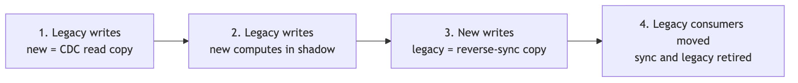
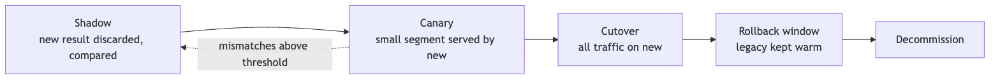
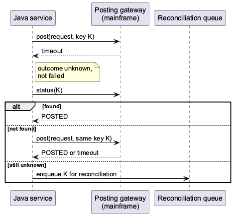

<!-- _class: lead -->
<!-- _backgroundColor: '#0d1b3e' -->
<!-- _color: '#ffffff' -->
<!-- _paginate: false -->

# Strangler Fig Is Not Enough

## Patterns for safe core banking modernization

**Wallace Espindola**
Solution Architect

<wallace.espindola@gmail.com>
linkedin.com/in/wallaceespindola | github.com/wallaceespindola

<!--
Hi, I'm Wallace. This talk is about modernizing a core banking system without a big-bang rewrite.
Everybody in the room has heard of the Strangler Fig pattern. My point today is that it is the migration framework, and only that. The work that keeps money correct during the migration is done by a handful of other patterns, and that is what I want to walk through.
Everything I show, including a small Java module with tests, is in a public repo. Link at the end.
-->

---

# The starting point

- COBOL and CICS on a mainframe post the ledger, run end-of-day batch and feed regulatory reports
- It works, it is audited, and it cannot go offline for a weekend cutover
- Channels want real-time APIs and a better mobile experience
- The people who know the rules are leaving

So the bank modernizes **one capability at a time**, while old and new run side by side.

<!--
The typical starting point. The mainframe is the system of record for ledger posting and settlement. It is fast and stable, and that is exactly why nobody wants to touch it.
The pressure comes from around it: channels expect real-time behavior, and knowledge is walking out of the door.
Big-bang replacement has a poor track record in this setting, so the realistic option is incremental: one capability at a time, with both systems live for a long while.
-->

---

# What Strangler Fig gives you

- A **facade** in front of the legacy system
- **Routes** that move one operation at a time to a new service
- A **rollback** that is a routing change, not a deployment

What it does not decide:

- what to extract
- who owns the data while both systems hold a copy
- how to prove the new answer equals the old one

<!--
Martin Fowler described the Strangler Fig Application years ago, and the idea holds: put something in front of the old system and move traffic gradually.
But look at the second list. Routing doesn't tell you what to extract, it doesn't move data, and it doesn't prove anything. In banking those three questions are where projects fail. The rest of the talk is the patterns that answer them.
-->

---

<!-- _class: diagram -->

# How the patterns fit together



<!--
This is the account inquiry example from the repo. The facade routes new reads to a Java service. Legacy paths and the fallback go through an anti-corruption layer. CDC feeds a read model with pending and posted balances. The new service runs in parallel with the legacy path until it proves equivalence. New events leave through an outbox. A reconciliation job compares the books on both sides.
Each box answers one of the questions from the previous slide.
-->

---

# Twelve patterns, twelve jobs

| Pattern | Job |
| --- | --- |
| Strangler Fig | move traffic one capability at a time |
| Anti-Corruption Layer | translate records, codes and meanings |
| Branch by Abstraction | swap a module routing can't isolate |
| DDD | decide what to extract |
| CDC + CQRS | feed and scale reads, writes stay on the ledger |
| Outbox + EDA | publish events reliably |
| Saga | multi-step flows with compensation, never ledger posting |
| Parallel Run | prove equivalence before cutover |
| Hexagonal | keep the domain free of the mainframe adapter |
| Circuit Breaker + Bulkhead | contain failures |

<!--
This is the whole catalog on one slide. The context file in the repo has a page on each.
Two warnings worth stating now. A saga is not a substitute for atomic ledger posting. And CQRS here does not mean event sourcing: the mainframe ledger is already your write model.
-->

---

# Decide what to extract

- Event Storming and a context map, not the program list
- Capabilities: Account Inquiry, Ledger Posting, Interest, Customer
- **Ledger posting is the core domain**: usually last to move, or retained
- Good first candidates: inquiry, notifications, statements

Avoid one microservice per COBOL program. That reproduces 1980s structure with network latency added.

<!--
DDD's job here is to find business capability boundaries. Legacy program structure reflects old online and batch splits, not capabilities.
Classify subdomains. The ledger is core, highly coupled and high risk, so it moves last or stays on the mainframe. Supporting capabilities like inquiry or notifications are where you prove your pipeline.
-->

---

# The anti-corruption layer translates meaning

- EBCDIC to UTF-8, COMP-3 packed decimal to `BigDecimal`
- Return codes and abends to domain errors
- Overloaded fields to explicit types
- "Balance" means ledger, available or memo-posted, depending on context. The ACL makes that explicit.

One ACL per bounded context, versioned contracts, no business logic. Retire it with the legacy capability behind it.

<!--
Syntax translation is the easy half: character sets, packed decimals, fixed-width records.
The valuable half is semantic. A field called balance in the legacy record can mean three different things. If the ACL doesn't make that explicit, the new service inherits the ambiguity.
And the ACL is transitional: if nothing sits behind it any more, delete it.
-->

---

# The ACL in code

```java
public AccountLookup translate(byte[] raw) {
    LegacyAccountRecord record = LegacyAccountRecord.parse(raw);
    return switch (record.returnCode()) {
        case OK -> new Found(new AccountBalance(record.accountId(), record.balance(), typeOf(record.typeFlag())));
        case NOT_FOUND -> new NotFound(record.accountId());
        case BLOCKED -> new Blocked(record.accountId());
        default -> throw new LegacyTechnicalException("Legacy return code " + record.returnCode());
    };
}

private static BalanceType typeOf(char flag) {
    return switch (flag) {
        case LEDGER_FLAG -> BalanceType.POSTED;
        case MEMO_POSTED_FLAG -> BalanceType.PENDING;
        default -> throw new LegacyTechnicalException("Unknown record type flag " + flag);
    };
}
```

`examples/account-modernization`, package `acl`

<!--
This is from the Java module in the repo. Return codes become a sealed result type, so callers can't forget the not-found and blocked cases. Technical codes become an exception.
And the record type flag becomes an explicit balance type: memo-posted is pending, ledger is posted. That's the semantic part of the translation.
-->

---

# Modernize reads first: CDC and CQRS

- CDC feeds a read model while the ledger stays authoritative
- Model **pending vs posted**: cores memo-post during the day, hard-post at end of day
- Lag SLO, per-account ordering, dedupe by log position, replay runbook
- Read-your-own-writes: pending overlay, version token, fallback to legacy

Check CDC feasibility per data store early: Db2 is mature, VSAM and IMS are harder.

<!--
Reads are the safest place to start. CDC copies committed changes into a read-optimized store, and the ledger keeps the truth.
The banking trap is intraday posting. If your read model doesn't model pending and posted separately, balances jump when the batch runs.
And customers expect to see their own payment right away, so you need a plan for read-your-own-writes, including a route back to the legacy read when lag breaches the SLO.
-->

---

<!-- _class: diagram -->

# Move data ownership in stages



**Exactly one writer at every stage. Never dual-write from application code.**

<!--
This is the part people skip. At every stage exactly one system owns writes, and the other receives data through CDC or a sync path.
Stage three is easy to forget: once the new service owns writes, legacy batch, reports and regulatory feeds still need the data, so you need reverse synchronization until those consumers have moved.
Dual writes from application code guarantee divergence on the first partial failure.
-->

---

# Publish events you can trust

- **Transactional outbox**: business change and event row in one local transaction (on the mainframe: same CICS unit of work)
- Relay by polling or log tailing, delivery is at least once
- **Idempotent consumer**: an inbox table keyed by event id
- Partition by account id for ordering; schema registry; DLQ with a runbook
- Keep personal data out of events, or crypto-shred it

<!--
If you publish an event after committing, you will eventually lose one. If you publish before, you will eventually send one for a change that rolled back. The outbox fixes that by putting the event in the same transaction.
That gives you at-least-once delivery, so consumers must be idempotent. The repo has a small in-memory version of both, with tests.
-->

---

# Prove it before you route it

- Run legacy and new on the same inputs, serve legacy, compare
- Tolerance rules, field mapping, known-difference allowlist, triage workflow
- Usual false mismatches: rounding mode, day count, business vs system date
- Shadow side effects off **by configuration**, not by convention

<!--
Parallel run is how you earn the right to switch a route. Legacy stays authoritative during the shadow phase; the new result is only compared.
Most mismatches are not bugs in the business logic. They are rounding mode, day-count convention, date handling. COBOL ROUNDED defaults to half up; Java BigDecimal needs an explicit rounding mode.
And the shadow path must never send a notification or post money. Make that impossible by configuration.
-->

---

<!-- _class: diagram -->

# From shadow to decommission



<!--
The rollout stages. Shadow first, then canary for a small segment while legacy is still computed and compared, then full cutover with legacy kept warm for a rollback window, then decommission.
Mismatches above the agreed threshold send you back to shadow. That loop is the safety net.
-->

---

<!-- _class: diagram -->

# A timeout is an unknown outcome



<!--
This one matters for every write that touches money. When a posting call times out, you don't know whether it happened.
So: an idempotency key end to end, query status before any retry, retry only with the same key, and anything still unknown goes to reconciliation. Never blind-retry a non-idempotent write.
Circuit breakers and bulkheads still apply, but on financial writes they must respect this rule. Retries also burn mainframe capacity, which is often what you pay for.
-->

---

# Unknown outcome in code

```java
public PostingResult post(PostingRequest request) {
    try {
        return gateway.post(request);
    } catch (PostingTimeoutException timeout) {
        return resolveUnknownOutcome(request);
    }
}

private PostingResult resolveUnknownOutcome(PostingRequest request) {
    Optional<PostingResult> alreadyPosted = lookup(request);
    if (alreadyPosted.isPresent()) {
        return alreadyPosted.get();
    }
    try {
        return gateway.post(request);
    } catch (PostingTimeoutException timeout) {
        return lookup(request).orElseGet(() -> park(request));
    }
}
```

`examples/account-modernization`, package `posting`

<!--
The same rule in Java. On a timeout, ask first. If the ledger already has it, you're done. If not, retry once with the same idempotency key. If you still don't know, park it for reconciliation instead of guessing.
The tests in the repo cover all three paths with a fake gateway.
-->

---

# Coordinate multi-step flows with sagas

- Loan origination, onboarding and KYC: orchestration over choreography
- Compensation is a **reversal entry**, not a rollback. Accounting never deletes
- Design the pivot step: irreversible and customer-visible actions after it
- Semantic locks (`PENDING_APPROVAL`) because sagas have no isolation

Not a substitute for atomic ledger posting.

<!--
Sagas fit long business processes that span services. In a bank, compensation maps naturally to reversal entries, as long as the ledger supports them.
Orchestration gives you one place to see state, audit and time out, which matters in regulated flows.
And the warning again: a saga coordinates steps, it does not make a posting atomic.
-->

---

# Seven phases, each with an exit criterion

1. **Discover**: contexts agreed, first capability picked, baseline metrics
2. **Encapsulate**: ACL plus facade as pass-through, correlation IDs
3. **Build the read side**: CDC, read model, lag SLO, fallback
4. **Prove**: parallel run, mismatches explained and signed off
5. **Shift reads**: canary to 100%, rollback tested
6. **Extend**: outbox events, replaced calculations
7. **Decommission**: clean reconciliation, audit evidence, sign-off

<!--
This is the account example as a plan. The key detail is phase two: install the facade early as a pass-through, with all traffic still going to legacy. Routes only flip after phase four.
Each phase has an exit criterion you can check. Decommission is gated by reconciliation and sign-off, not by passing tests.
-->

---

# Anti-patterns to call out early

- Distributed monolith, one service per COBOL program
- Dual writes from application code
- New services reading legacy tables directly
- Ledger first
- Perpetual strangler: no decommission criteria
- Big-bang data migration disguised as incremental
- Leaky ACL: legacy names and codes in new APIs

<!--
Every one of these shows up in real programs. The perpetual strangler is the expensive one: the bank pays for both stacks indefinitely because nobody defined when the transitional pieces get removed.
Put a removal date on every facade route, ACL and sync pipeline when you build it.
-->

---

# Where the architect adds value

- Pick the pattern for the problem, avoid pattern-driven overengineering
- Own data ownership, transaction semantics and cutover gates
- Record decisions as ADRs: auditors ask why, years later
- Align with DORA, BCBS 239 and PCI DSS; plan exit strategies
- Model the cost of coexistence: usually the most expensive period
- Decide what stays on the mainframe

<!--
The architect's job is choosing, not collecting patterns. Most of the value is in data ownership, transaction semantics and the gates.
In the EU, DORA has applied since January 2025, and it covers operational resilience and ICT third-party risk, including exit strategies. That shapes how you use cloud and AI providers in the program.
-->

---

# Where AI helps, and where it must not decide

**Helps:** dependency discovery, candidate rule extraction, copybook to schema mapping, characterization test candidates, parallel-run mismatch clustering, documentation recovery.

**Guardrails:** every rule cites program and line, generated tests are checked against real legacy output, approved deployment models for source code, no line-by-line COBOL-to-Java transliteration.

AI proposes, deterministic tooling verifies, people approve.

<!--
AI shortens the slow parts: reading a large estate, drafting rules, generating test candidates, sorting thousands of mismatches into a few root causes.
It does not get authority over financial behavior. Traceability to source is the control that makes extracted rules reviewable.
And watch out for "JOBOL": Java that keeps the COBOL structure. Use AI to understand and re-express rules, not to transliterate.
-->

---

# Pattern shortcuts

| Goal | Patterns |
| --- | --- |
| Replace gradually | Strangler Fig + ACL |
| Modernize reads first | CDC + CQRS |
| Publish reliable events | Outbox + idempotent consumer |
| Replace an internal module | Branch by Abstraction + characterization tests |
| Prove equivalence | Parallel Run + reconciliation |
| Move write ownership | staged transfer + reverse sync |
| Safe financial writes | idempotency key + status inquiry |

<!--
If you remember one slide, take this one. Each row is a goal and the pair of patterns that usually answers it.
-->

---

# Takeaways

- Strangler Fig moves traffic. It does not move data or prove correctness
- One writer at every stage, and a removal date on every transitional piece
- Model pending vs posted; treat timeouts as unknown outcomes
- Prove with a parallel run, gate with reconciliation
- A capability is done when the new system owns its data, the books balance and the legacy path is off

<!--
To close. Strangler Fig is the framework; DDD decides what to extract; the ACL protects the new design; CDC, CQRS and the outbox let both systems coexist; parallel runs and reconciliation decide when you are done.
-->

---

<!-- _class: lead -->
<!-- _backgroundColor: '#0d1b3e' -->
<!-- _color: '#ffffff' -->
<!-- _paginate: false -->

# Thank you

## Context, Java examples, diagrams and slides

[github.com/wallaceespindola/legacy-modernization-patterns](https://github.com/wallaceespindola/legacy-modernization-patterns)

**Wallace Espindola**, Solution Architect
linkedin.com/in/wallaceespindola | speakerdeck.com/wallacese

<!--
Thanks. The repo has the full pattern context, the Java module with tests, the diagrams and these slides. I'm happy to take questions.
-->
